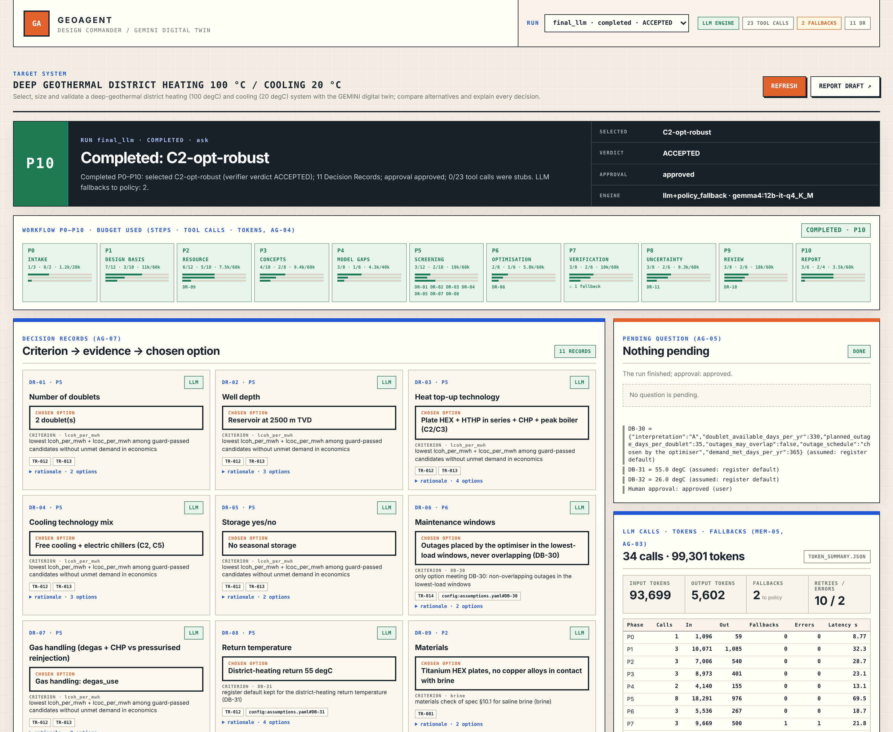

# GeoAgent — agentic design of a deep-geothermal district heating and cooling system

SPE GeoHackathon 2026 entry built on the [GEMINI geothermal digital twin](README_GEMINI.md)
(this repository is a fork; GEMINI's own README is kept as `README_GEMINI.md`).

GeoAgent is an agentic AI application that selects, sizes and validates a deep-geothermal
district **heating (100 °C supply)** and **cooling (20 °C supply)** system for the challenge brief:
it compares nine alternatives (C0–C8), explains every decision in a Decision Record, runs the
GEMINI simulator for a full year, verifies the design against 46 checks, quantifies cost, CO₂,
exergy and uncertainty, and logs every prompt, answer and token. The LLM is an open-weight model
served locally by Ollama; nothing leaves the laptop.

**At a glance** (numbers from the Results section below and its source files):

- **Selected design C2-opt-robust**: two doublets at 2500 m, plate HEX + HTHP, CHP, peak boiler,
  free cooling + electric chillers; verifier **ACCEPTED (46/46 checks)**, human approval **approved**.
- **Economics and CO₂**: LCOH 44.6 / LCOC 26.3 USD/MWh, CAPEX 30.1 MUSD, CO₂ −72 % vs the gas
  counterfactual C0.
- **Demand**: 100 % of the heating and cooling demand met on all 365 days (0 unmet MWh);
  P(demand met) 0.90 with the P90 peak boiler (TL-15, 200 samples).
- **LLM**: gemma4:12b-it-q4_K_M (open-weight 12B, 4-bit) on a MacBook Pro M3 36 GB via Ollama;
  34 calls, 99 301 tokens, ≈ 14.5 min wall time; every prompt, answer and token is logged.
- **Reproduce offline in one command** (no GPU, no network, no LLM):
  `PYTHONPATH=src python -m gemini_agent.cli run --engine policy`.

## Design principle: agents propose, tools compute, the verifier accepts, the human approves

```
 USER (CLI: --input-mode ask | assume | pause/resume)
   │
 WORKFLOW RUNNER  deterministic phases P0–P10, SQLite event log, budgets, pause/resume
   │              (adapted from Plant Debugger's incident runner)
   ▼
 AGENTS           Pydantic AI role agents on a local Ollama model (Lead Engineer, Requirements,
                  Subsurface, System Architect, Model Builder, Economics, Reviewer, Reporter);
                  structured outputs, ≤ 2 retries, then a deterministic PolicyEngine fallback
   │  typed tool calls (3–6 tools per role)
   ▼
 TOOLS            deterministic, unit-tested Python (TL-01…TL-23): design basis, climate, resource,
                  doublet hydraulics/ESP, config generator, DesignGuard, annual simulation and
                  dispatch, optimiser, Monte Carlo, economics/CO₂/exergy, scaling, plots, report
   ▼
 ENGINE           GEMINI gemini_model + gemini_simulator (+ 7 new and 4 extended models, registry)
   ▼
 VERIFICATION     DesignGuard (hard limits) · DesignVerifier (46 checks, 4 layers) · Reviewer
                  agent · human approval — only DesignVerifier can mark a design ACCEPTED
   ▼
 EVIDENCE         events.jsonl/sqlite · tool_results/TR-*.json · llm_calls.jsonl ·
                  token_summary.json · decision_records/ · figures · report_draft.md
```

- **The LLM never computes a number.** Every physics, sizing, cost and KPI value comes from a
  deterministic tool; report numbers are copied from tool outputs.
- **No invented coefficients.** Equations and values come from the reference cards in
  `data/knowledge/reference_cards/RC-*.md`; every assumption is an entry in
  `config/assumptions.yaml` with its source and tag.
- **Hard limits** (1–3 doublets, 50–300 m³/h per doublet, brine cooling ≤ 40 K, pump efficiency
  70 %, Q_inj = Q_prod, 100 °C / 20 °C supply) are enforced by `DesignGuard` before any
  simulation and re-checked by `DesignVerifier`.
- **Models are choosers.** Each phase offers bounded options with evidence ids; the model picks
  and must name the decisive criterion; a typed validator rejects anything else.

## Results of the final run (gemma4:12b-it-q4_K_M, laptop, `runs/final/final_llm/`)

Selected design **C2-opt-robust**: two doublets at 2500 m, plate HEX + high-temperature heat
pump in series, CHP on the associated gas, peak boiler, free cooling + electric chillers, no
seasonal storage; verifier verdict **ACCEPTED** (46/46 checks), human approval **approved**.
The design meets 100 % of the heating and cooling demand on all 365 days of the simulated year
(0 unmet MWh for heating and for cooling).
Full tables with their source files: [`docs/results/REPORT.md`](docs/results/REPORT.md).

| Item | Value | Source |
|---|---|---|
| Doublets · depth · flow per doublet | 2 · 2500 m · 296 m³/h | `runs/final/final_llm/figures/sizing.md` |
| Installed heating · cooling | 36.3 MW · 16.8 MW | same |
| HTHP · electric chiller · peak boiler | 4.10 · 8.20 · 10.90 MW (C2-opt had 5.00 MW boiler) | same |
| Wellhead T · ESP · injection pump (per doublet) | 85.2 °C · 58.1 Hz, 0.446 MW_e · 0.339 MW_e | same |
| Thermal breakthrough (design flow) · well spacing | 34.4 yr · 1200 m | same |
| Unmet demand (365 d) | heating 0 d / 0 MWh, cooling 0 d / 0 MWh | `report_draft.md` → Answer |
| LCOH · LCOC (30 yr) · CAPEX | 44.6 · 26.3 USD/MWh · 30.1 MUSD | same |
| CO₂ | 7 360 t/yr, 72 % below the C0 counterfactual (26 332 t/yr) | same; `figures/candidates.md` |
| Exergy efficiency | 0.44 (T₀ = daily dry bulb, De Bilt) | same |
| Robustness before → after DR-11 | P(demand met) 0.46 → 0.90 (TL-15, 200 samples) | same; `uncertainty_C2-opt.json` |
| Cost of the robust backups (DR-11) | ΔLCOH +2.05, ΔLCOC +0.00 USD/MWh, ΔCAPEX +2.21 MUSD | same; `tool_results/TR-019_robust_backup.json` |
| Monte Carlo LCOH P10 / P50 / P90 | 33.8 / 47.3 / 66.1 USD/MWh (C2-opt) | `figures/uncertainty.md` |
| Sensitivity cases (TL-15 UQ-CASES, C2-opt base sizes) | DB-31 45/65/75 °C: LCOH 36.5 / 54.7 / 74.9; ECO-CO2-GAS 51.53: LCOH 42.5; CHP-EL-FRAC 0.50: LCOH 41.4, LCOC 25.8, CO₂ −245 t/yr, 23 MWh unmet heat (2 days); SUB-PBUB pure water, DB-34b warm, DB-30 B: 0 unmet | same; `uncertainty_C2-opt.json` → `cases` |

Alternatives (fast-year screening points, TL-12 + TL-14; `runs/final/final_llm/figures/candidates.md`):

| Candidate | Concept | LCOH | LCOC | CO₂ cut vs C0 | Note |
|---|---|---|---|---|---|
| C0-0d | gas boilers + electric chillers (counterfactual) | 137.0 | 36.0 | – | |
| C1-3d | 3 doublets at 2.5 km, plate HEX + gas boiler/CHP top-up, electric chillers | 54.2 | 23.6 | 47 % | |
| C2-2d | 2 doublets at 2.5 km, HEX + HTHP in series + CHP + peak boiler, free cooling + electric chillers | 50.3 | 26.3 | 75 % | optimised → C2-opt 42.5 / 26.3 |
| C3-2d | as C2, free cooling + absorption chillers + electric peak | 50.0 | 40.4 | 75 % | |
| C4-2d | 2 doublets at 3.2 km, direct plate HEX (no HTHP), absorption cooling | 29.4 | 38.7 | 83 % | excluded: PH-19 NPSH (ESP) |
| C5-3d | 3 doublets at 1.5 km, large heat pumps, free cooling + electric | 104.5 | 26.1 | 46 % | |
| C6-2d | C2 + seasonal HT-ATES | 50.3 | 26.3 | 75 % | storage unpriced (no RC-10 capex) |
| C7-2d | C2 with a pressurised loop, gas reinjected (no degassing) | 62.1 | 27.3 | 76 % | |
| C8-3d | C2 + 1 doublet as N-1 redundancy | 57.0 | 26.3 | 75 % | |
| **C2-opt-robust** | C2-opt + TL-15 P90 backups | **44.6** | **26.3** | **72 %** | selected, ACCEPTED |

Figures: `docs/results/final_llm/` (copies of `runs/final/final_llm/figures/`), captions in
`docs/results/REPORT.md` §13.

## Agent and LLM evidence

**Final run** (`runs/final/final_llm/token_summary.json`, `run_summary.json`): 34 LLM calls,
99 301 tokens (93 699 in / 5 602 out), 299 s of model latency (≈ 14.5 min wall time,
`events.jsonl` 22:26:15 → 22:40:47), 2 policy fallbacks, 0 of 23 tool
calls were stubs, 11 Decision Records (10 decided by the model, DR-10 by the policy fallback
after the model twice named a criterion that was not offered), approval `approved` in ask mode.
Hardware (operator's note, not recorded by the run): MacBook Pro M3, 36 GB, Ollama with
`OLLAMA_CONTEXT_LENGTH=65536`.

**S1–S11 evaluation** (`runs/final/eval/gemma4_12b-it-q4_K_M/EVAL_REPORT.md`, quick tool
profile, rerun on 2026-11-04 after [#29](https://github.com/Amaechi/gemini_digital_twin_private/pull/29)
and [#32](https://github.com/Amaechi/gemini_digital_twin_private/pull/32), merged as
[#39](https://github.com/Amaechi/gemini_digital_twin_private/pull/39)): **8 pass** (S1, S2, S3,
S4, S5, S6, S8, S9), **3 pending** (S7, S10, S11), **0 fail**; 46 of 46 checks pass, 0 token-budget
overruns (`eval_results.json`, `model_comparison.json`). S2 pauses in P1 with one
`CFG-INPUT-DEFAULTS` question that lists the missing inputs and runs no tool; S5 records
`CFG-BASIS-CONFIRM = keep` and completes on the 100 °C basis; S8 re-sizes against S1 of the same
eval (PI 3.06 vs 12.22 m³/h/bar: ESP 49 stages at 1560 m, 1.43 MW peak vs 16 stages at 840 m,
0.46 MW). The three pending scenarios complete (S7 and S11 ACCEPTED in P10) and each names the
check that is not automated: S7 — the policy engine's P4 runs the gap analysis only (WP-12
decision); the LLM Model Builder writes and tests the model in the local Ollama run, evidence in
[`docs/results/s7_demo/`](docs/results/s7_demo/README.md) (2 drafts, 2 passing tests); S10 — the
token comparison figure (the report tables the comparison); S11 — the 16 GB vs 36 GB comparison
needs two local runs and `run_eval.py --compare` (the table below).

**§4.3 settings study** ([`docs/results/SETTINGS_STUDY.md`](docs/results/SETTINGS_STUDY.md),
`eval_results.json` of each run in `docs/results/settings_study/`): S11 on gemma4:12b-it-q4_K_M
with thinking on and with `OLLAMA_CONTEXT_LENGTH=32768`, against the submitted settings (thinking
off, 64K). All three complete with the same ACCEPTED design; thinking on spends the 2 048-token
output cap on reasoning in 11 of 34 calls (policy fallbacks 11, validity 68 %, wall time × 2.7);
32K is indistinguishable from 64K (32/32 valid, 0 fallbacks; largest prompt 4 608 tokens).

**S10 naive vs optimised context** (`runs/final/eval/gemma4_12b-it-q4_K_M/S10-token_comparison.json`):
173 909 → 108 937 tokens for the same task (34 naive / 33 optimised calls), a **37 % saving**
from the compacted history and tool-result summaries.

**S11 model comparison** (one S11 run per model, `runs/final/eval/<model>/eval_results.json`):

| Model (Ollama tag) | Class | Outcome | LLM calls | Tool-call validity | Fallbacks | Tokens | Runtime |
|---|---|---|---|---|---|---|---|
| gemma4:12b-it-q4_K_M (chosen) | 16 GB | completed, ACCEPTED | 33 | 97 % | 1 | 88 524 | 373 s |
| qwen3.6:27b | 36 GB | completed, ACCEPTED | 38 | 82 % | 7 | 126 855 | 673 s |
| qwen3.6:35b-a3b | 36 GB | escalated in P6 (tool-call budget) | 29 | 97 % | 1 | 79 061 | 167 s |
| gemma4:26b-a4b | 24–36 GB | escalated in P5 (DR-08 token limit) | 27 | 70 % | 7 | 101 871 | 176 s |
| qwen3.5:9b-q4_K_M | 16 GB | escalated in P5 (tool-call budget) | 22 | 68 % | 7 | 83 724 | 203 s |

(qwen3.6:27b eval outcome pending = the cross-model check is not automated; the row is read from
its `eval_results.json`.)

The gemma4:12b row is the S11 of its S1–S11 eval. Its earlier S11-only run (L-1, the basis of the
model choice: completed, 100 % validity, 0 fallbacks, 79 k tokens, 328 s) was overwritten by the full eval because `run_eval.py` rewrites
`eval_results.json` on every call; `runs/final/eval/model_comparison.json` was generated after
that and therefore sums all 12 gemma4 runs. See Limitations.

**Second full pipeline run with a 36 GB-class model** (`runs/final_qwen27b/final_llm/`, qwen3.6:27b,
`--budget full`, ask mode, L-3): same selected design and the same verdict as the submitted gemma4
run (C2-opt-robust, ACCEPTED, 11 Decision Records with identical choices); approval **pending**
(the operator pressed Enter at the P10 approval prompt, so the run is complete but no approval
was recorded). Numbers from `token_summary.json` and `run_summary.json` of each run:

| Run | Class | Outcome | LLM calls | Tokens | Requests / retries | Policy fallbacks | Stub tool calls | Model latency |
|---|---|---|---|---|---|---|---|---|
| gemma4:12b-it-q4_K_M (`runs/final/`, submitted) | 16 GB | C2-opt-robust ACCEPTED, approval approved | 34 | 99 301 (93 699 in / 5 602 out) | 44 / 10 | 2 | 0/23 | 299 s |
| qwen3.6:27b (`runs/final_qwen27b/`) | 36 GB | C2-opt-robust ACCEPTED, approval pending | 37 | 136 882 (127 820 in / 9 062 out) | 59 / 22 | 7 | 0/26 | 621 s |

The larger model used +38% tokens and +108% model latency (≈ 16 min wall time,
`events.jsonl` 23:09:13 → 23:25:13) and fell back to the policy on 7 Decision Records
(DR-01, DR-02, DR-03, DR-05, DR-08, DR-09, DR-10; in all seven `llm_calls.jsonl` records the
validator rejected the answer twice because the named criterion was not one of the offered
criterion ids) against one (DR-10) for gemma4. Every fallback choice equals the choice gemma4 made
itself in the submitted run, so the design, the verifier verdict and the report tables agree. The
run is evidence that the pipeline is model-independent, not a replacement for the submitted run:
`validate_submission.py` reads `runs/final/` only.

## Reproduce

Python 3.12, no GPU, no network and no LLM are needed for the policy engine. Install:

```bash
uv venv -p 3.12 .venv && source .venv/bin/activate && uv pip install -r requirements-hackathon.txt
```

One command, deterministic (the policy engine reaches the same selected design and verdict;
DR-10 in the LLM run was a policy fallback; ≈ 9 min with the full budget on a
2–4-core machine; `--budget smoke` gives the CI-sized run, ≈ 23 s):

```bash
PYTHONPATH=src python -m gemini_agent.cli run --engine policy
```

Outputs land in `runs/<run-id>/` (`run_summary.json`, `report_draft.md`, `decision_records/`,
`figures/`, `tool_results/`, `events.jsonl`). The committed policy run is `runs/final_policy/`.
Other commands:

```bash
PYTHONPATH=src python -m pytest -q unit_test/gemini_model unit_test/gemini_simulator unit_test/gemini_agent -x
```

```bash
PYTHONPATH=src python scripts/validate_submission.py --pytest
```

```bash
PYTHONPATH=src python scripts/build_results.py --run-id final_policy
```

```bash
PYTHONPATH=src python scripts/build_report_pack.py
```

`--speak` on `run`, `resume` and `whatif` (post-submission) additionally reads each question
with its default, the P10 summary with the verifier verdict, the DR-11 rationale and the what-if
verdicts aloud through the macOS `say` command; elsewhere it prints one note and changes nothing
(`src/gemini_agent/speech.py`; the subprocess is monkeypatched in the tests). Example:

```bash
PYTHONPATH=src python -m gemini_agent.cli run --engine policy --input-mode ask --speak
```

### What-if on a finished run

`cli whatif` (post-submission feature) changes one or more bounded design levers of a finished run's
selected design, reruns the TL-12 year, TL-14 economics (+ CO₂ vs C0, exergy) and the
DesignGuard/DesignVerifier on the changed design, and prints a before → after table. It reads the run
and writes only `runs/<id>/whatif/<n>/` (`whatif.json`, `whatif.md`, a Decision-Record-style
`DR-W<n>.json/.md` with evidence keys, `tool_results/`); the run's own files stay byte-identical
(tested). No LLM is involved; every number comes from the same deterministic tools as the run.

```bash
PYTHONPATH=src python -m gemini_agent.cli whatif --run-id final_llm --runs-dir runs/final --set DB-31=65 --budget quick
```

Output on the submitted run (39 s; margin rows other than the boiler's omitted here):

| Metric | Unit | before (C2-opt-robust) | after (C2-opt-robust-w1) | Δ |
|---|---|---|---|---|
| LCOH | USD/MWh | 44.59 | 58.42 | +13.83 |
| LCOC | USD/MWh | 26.31 | 26.51 | +0.20 |
| CAPEX | MUSD | 30.07 | 29.99 | -0.08 |
| OPEX | MUSD/yr | 2.28 | 3.51 | +1.22 |
| CO2 | t/yr | 7,360 | 10,609 | +3,249 |
| CO2 reduction vs C0 | frac | 0.721 | 0.597 | -0.123 |
| unmet heating days | d | 0 | 0 | +0 |
| unmet cooling days | d | 0 | 0 | +0 |
| exergy efficiency | frac | 0.440 | 0.356 | -0.084 |
| P(demand met) | frac | 0.900 | n/a | n/a |
| min margin peak_boiler_capacity_margin_mw | mw | 5.93 | 0.20 | -5.73 |
| DesignGuard / verifier | | guard APPROVED / verifier ACCEPTED | guard APPROVED / verifier ACCEPTED | |

A 65 °C return leaves less heat to the direct HEX, so the heat pumps and the boiler run more
(OPEX, CO₂ and LCOH up) while the DR-11 P90 boiler still covers every day with 0.20 MW to spare;
`--set OPT-ROBUST-BACKUP=off` reproduces DR-11's deltas (CAPEX −2.21 MUSD, LCOH −2 USD/MWh).
Levers (`--set`, repeatable; `whatif --help` lists them with their bounds): `DB-31`, `DB-32`
(return temperatures, register range), `DB-30=A|B`, `ECO-CO2-GAS`, `CHP-EL-FRAC` (register range),
`OPT-ROBUST-BACKUP=on|off` (the run's TL-15 robust nameplates), `design_flow_m3h`, `doublets`
(DesignGuard DB-10/11), `concept=<id>` (re-pick a screened candidate of the run). An out-of-limit
lever is refused with the guard's reason (`doublets=5` → "DB-10: 5 doublets outside 1–3", exit 5);
an unknown lever lists the valid ones (exit 2). `--budget full` also reruns the TL-15 Monte Carlo
on the changed design for its P(demand met) (the before value is the run's own TL-15 result, as
`probability_source` records); `--budget smoke` is the CI day subset (no `DB-30=B`).
The same function is `gemini_agent.tools.whatif.whatif(run_dir, levers, budget) -> WhatIfResult`.

### Review loop (`run --review`)

`cli run --review` (post-submission feature; default off, so every run and eval without the flag
is unchanged) adds a user review after the P9 verifier verdict. The runner asks
"Any objection to the recommended design? (Enter = none)"; free text such as *the boiler is too
big* or *I'd prefer 3 doublets* goes to the Lead Engineer role, whose structured output
(`LeverChoice`) maps it to **exactly one** bounded what-if lever and value (the list above) or
"no lever matches", in which case the reason is shown and the question repeated (max 3 rounds).
The runner then runs the same `whatif(...)` as `cli whatif` on the live run (`runs/<id>/whatif/<n>/`),
prints the before → after KPI table with the DesignGuard / verifier verdicts and asks "adopt the
change? yes/no". *Yes* reruns P6–P9 on the changed design through the verifier loop-back path
(counted against the ≤ 3 loops): TL-13 sizes from the adopted design (its doublets, depth and
return temperatures fixed; the runner-only `optimise_design` argument `candidate_id`), P7–P9
verify it, and the review is
asked again. DR-12 "User review: \<objection\> → \<lever\>" records adopted or kept with the
what-if evidence (`TR-…` id, the `DR-W<n>` record). Golden rule 1 holds: the LLM only picks a
lever, every number is a tool result; the policy engine maps a few keyword patterns
(boiler/backup, return temperature, doublets, depth, flow, concept, DB-30), so this also works
offline:

```bash
PYTHONPATH=src python -m gemini_agent.cli run --engine policy --input-mode ask --review --budget quick
```

Pause mode works too (`resume --answer "the boiler is too big"`, then `--answer yes`). Adoptable
levers: `DB-31`, `DB-32`, `DB-30` (recorded as user answers), `doublets`, `concept`,
`OPT-ROBUST-BACKUP` (`off` removes the DR-11 robust option in the rerun). `design_flow_m3h` is a
TL-13 size variable and `ECO-CO2-GAS` / `CHP-EL-FRAC` are register values: their what-if is shown
but cannot be adopted in a run. DR-12 holds the last review of the run; earlier adoptions are
listed in its rationale and in the `REVIEW_*` / `LOOP_BACK` events.

**Laptop LLM run** (needs [Ollama](https://ollama.com)). Models per hardware are in `config/llm.yaml`: profile
`16gb` (qwen3.5:9b orchestrator, gemma4:12b coder) and `36gb` (qwen3.6:35b-a3b, qwen3.6:27b);
`--model <tag>` uses one tag for every role. The settings below are **server** settings:

```bash
OLLAMA_MAX_LOADED_MODELS=1 OLLAMA_NUM_PARALLEL=1 OLLAMA_CONTEXT_LENGTH=65536 OLLAMA_FLASH_ATTENTION=1 OLLAMA_KV_CACHE_TYPE=q8_0 ollama serve
```

```bash
PYTHONPATH=src python scripts/run_eval.py --engine llm --model <model-a> --tool-profile quick --scenarios S11 --eval-root runs/final/eval
```

```bash
PYTHONPATH=src python scripts/run_eval.py --compare runs/final/eval/<dir-a> runs/final/eval/<dir-b> --eval-root runs/final/eval
```

```bash
PYTHONPATH=src python -m gemini_agent.cli run --engine llm --model <model> --budget full --runs-dir runs/final --run-id final_llm --input-mode ask
```

```bash
PYTHONPATH=src python scripts/run_eval.py --engine llm --model <model> --tool-profile quick --eval-root runs/final/eval
```

```bash
PYTHONPATH=src python -m gemini_agent.agents.model_builder --sandbox runs/s7_demo --model <model> --max-attempts 3
```

### Web view (optional)

`cli serve` (spec §4.2 MAY, post-submission) is a read-only web "Design Commander" for the runs of a
directory: the shell of Plant Debugger's static Commander page (Apache-2.0, adapted in
`src/gemini_agent/ui/static/` with the licence header) on a standard-library `http.server` — no new
dependency. It shows, per run, the phase timeline P0–P10 with the AG-04 budgets used (steps, tool
calls, tokens), the tool calls with their stub flag, LLM calls / tokens / fallbacks per phase, the
Decision Record cards (criterion, evidence ids, chosen option, rationale), the DesignVerifier report
with every check's margin, the figures, and — for a paused run — the pending question with an Answer
box and, in P10, Approve / Reject buttons. Answering goes through the same `DesignRunner.resume` and
validation as `cli resume` (an invalid answer returns 400 and the run stays paused); nothing else
writes into the runs directory (`--read-only` disables even that). The page computes no number: every
value is read from `events.sqlite`, `run_summary.json`, `decision_records/`, `tool_results/`,
`figures/` and `token_summary.json`.

```bash
PYTHONPATH=src python -m gemini_agent.cli serve --runs-dir runs/final --port 8765
```

Then open <http://127.0.0.1:8765/> (`?run=<id>` selects a run). JSON API: `/api/runs`,
`/api/runs/<id>` (overview + timeline), `/tools`, `/records`, `/verifier`, `/figures[/<name>]`,
`/events?after=N`, `/report`; `POST /api/runs/<id>/answer {"answer": "..."}` and
`POST /api/runs/<id>/approve {"decision": "approve"|"reject"}`. Resuming an LLM run needs the local
Ollama model the run was started with (or `--engine policy`).



### Voice (experimental)

`cli talk` (post-submission) is a push-to-talk front-end around the same run as `cli run
--input-mode ask`: you speak the design request and every answer, the assistant speaks the
questions and the verdict. Nothing else changes — the runner, DesignGuard, DesignVerifier and the
P10 approval are the ones `run` uses, and no number is computed by voice or by the LLM
(`src/gemini_agent/ui/voice.py`).

How a session goes:

1. **Request.** "Describe the design request" — press Enter, speak, press Enter again. The clip is
   transcribed offline by [faster-whisper](https://github.com/SYSTRAN/faster-whisper) (model
   `small`, CPU int8) and echoed: `I heard: "…"` then `use it? [Y/n]`. The confirmed text is the
   run's `--prompt`.
2. **Questions.** Every `InputRequest` of the run (DB-30 interpretation, return temperatures, the
   S2/S5 intake questions) is spoken with its default, then recorded. One LLM call with the
   `NativeOutput` schema `NormalisedAnswer` turns the transcript into the expected form —
   `sixty-five degrees` → `65`, `option B` → `B`, `yes please` → `yes`, "the default" → the
   register default — and is validated against what the runner accepts, logged in
   `llm_calls.jsonl` (`agent` = `voice_normaliser`) and, on failure, replaced by a keyword
   normaliser (`--engine policy` uses only the keywords, so numbers must be spoken as digits).
   The result is echoed, `I understood 65 degC - apply? [Y/n]`, and only a confirmed value reaches
   the runner, which validates it exactly like a typed answer (three unusable attempts → the
   register default is recorded as an assumption, as when Enter is pressed in ask mode).
3. **Approval.** In P10 the verifier's stored summary and the recommended design are spoken, and
   the approval is your spoken yes/no, confirmed on the keyboard. Then the run summary, the
   verdict and the DR-11 rationale are read as with `--speak`.

Install on a Mac (optional packages, pinned in `requirements-voice.txt`; the main CI never
installs them — `talk` imports them lazily and prints the install hint when they are missing):

```bash
uv pip install -r requirements-voice.txt
```

The first run downloads the `small` model (≈ 0.5 GB) into the Hugging Face cache; each utterance
then takes a few seconds on the CPU (CTranslate2 has no Metal backend). Speech output uses the
macOS `say` command (printed only elsewhere; `--mute` prints only).

```bash
PYTHONPATH=src python -m gemini_agent.cli talk --engine llm --model <tag> --budget quick
```

`--typed` replaces the microphone by the keyboard (no optional package needed; also how the tests
drive the loop), `--stt-model` picks another faster-whisper size, `--engine policy` runs without
Ollama. Limits: English transcription, no barge-in while the assistant speaks; Ctrl-C ends the run
like `run`.

**Dialogue: what-if by voice.** After the approval — or at once with `talk --run-id <id>` on a
completed run — the assistant asks "What would you like to change?" and loops (max 5 rounds,
`src/gemini_agent/ui/dialogue.py`): your request is echoed and confirmed, mapped by the Lead
Engineer role with the review loop's schema (`ReviewQuestion` → one bounded `LeverChoice`; keywords
with `--engine policy`), echoed again ("I understood: change the heating return temperature to 65
degrees Celsius — compute the what-if?"), computed with the same `whatif(...)` as `cli whatif`,
and read back as three sentences whose numbers come from the `WhatIfResult` table, rounded, with
units. "Adopt it, try another, or stop?" — *adopt* is the review loop's adoption
(`DesignRunner.adopt_whatif`: P6–P9 rerun on the what-if design, TL-13 pinned to it, DR-12 "User
review", the new P10 approval asked by voice), *another* starts the next round, *stop* ends.
Without an adoption nothing outside `runs/<id>/whatif/` is written (the what-if folders,
`dialogue.jsonl`, and on a completed run the dialogue's `llm_calls.jsonl`); adopting rewrites the
run's P6–P10 records like a review-loop adoption, so on the repository's submitted `runs/final*`
directories *adopt* is never offered (copy the run elsewhere first). `--no-dialogue` ends `talk`
at the approval. Example on a copy of the submitted run (`--budget quick`; the numbers are the
what-if tool's; `>` marks what you say, `[Y/n]` the keyboard confirmations):

```text
We can now explore changes to the recommended design C2-opt-robust as what-ifs; nothing is adopted without your confirmation.
What would you like to change? Name one design lever, for example the heating return temperature, the number of doublets or the backup boiler. Say stop to end.
> change the return temperature to 65
I heard: "change the return temperature to 65"          Use it? [Y/n]
I understood: change the heating return temperature (DB-31) to 65 degrees Celsius.   Compute the what-if? [Y/n]
What-if 1: changing the heating return temperature from 55 degrees Celsius to 65 degrees Celsius turns the recommended design C2-opt-robust into C2-opt-robust-w1. Before to after: LCOH from 44.6 to 58.4 dollars per megawatt-hour, LCOC from 26.3 to 26.5 dollars per megawatt-hour, CAPEX from 30.1 to 30.0 million dollars, CO2 from 7360 to 10609 tonnes per year. Unmet heating days from 0 to 0, unmet cooling days from 0 to 0, P(demand met) 0.90 before, not recomputed with the quick budget; the DesignGuard approved and the verifier says ACCEPTED for the what-if design.
Adopt it, try another, or stop?
> try another
I heard: "try another"                                   I understood another - apply? [Y/n]
What else would you like to change? Say stop to end.
> try 3 doublets
I heard: "try 3 doublets"                                Use it? [Y/n]
I understood: change the number of doublets (doublets) to 3.   Compute the what-if? [Y/n]
What-if 2: changing the number of doublets from 2 to 3 turns the recommended design C2-opt-robust into C2-opt-robust-w2. Before to after: LCOH from 44.6 to 48.5 dollars per megawatt-hour, LCOC from 26.3 to 26.3 dollars per megawatt-hour, CAPEX from 30.1 to 37.9 million dollars, CO2 from 7360 to 7581 tonnes per year. Unmet heating days from 0 to 0, unmet cooling days from 0 to 0, P(demand met) 0.90 before, not recomputed with the quick budget; the DesignGuard approved and the verifier says ACCEPTED for the what-if design.
Adopt it, try another, or stop?
> stop
I heard: "stop"                                          I understood stop - apply? [Y/n]
Dialogue over: 2 what-ifs computed, 0 adopted.
```

The printed output also holds the full before → after table of each what-if. A request no lever
expresses ("make it cheaper") is answered with the reason and asked again; a lever outside its
bound ("5 doublets") is refused with the DesignGuard's reason; `design_flow_m3h`, `ECO-CO2-GAS`
and `CHP-EL-FRAC` are computed but cannot be adopted (the prompt then offers *another* or *stop*
only). The three-turn dialogue above is the offline test (`unit_test/gemini_agent/ui/test_dialogue.py`,
fake STT/TTS/LLM, real what-if tool): two `whatif/<n>/` records, the run's files byte-identical.

## Where the evidence is

| Path | Content |
|---|---|
| `runs/final/final_llm/` | the submitted LLM run: `llm_calls.jsonl` (every prompt, answer, tokens, latency), `token_summary.json`, `events.jsonl`/`events.sqlite`, `tool_results/TR-001…023.json`, `decision_records/DR-01…11.{json,md}`, `report_draft.md`, figures, annual CSVs, optimisation/uncertainty/sensitivity JSON |
| `runs/final/eval/` | S1–S11 transcripts of the chosen model, S11 of four other models, `model_comparison.{json,md}`, `S10-token_comparison.json` |
| `runs/final_qwen27b/final_llm/` | second full LLM run (qwen3.6:27b, L-3): same file set as the submitted run (`llm_calls.jsonl`, `token_summary.json`, `events.jsonl`, `tool_results/TR-001…026.json`, `decision_records/`, `report_draft.md`, figures, annual CSVs); approval pending; not read by `validate_submission.py` |
| `runs/final_policy/` | the same workflow on the deterministic policy engine (reference run, built by `scripts/build_results.py`) |
| `docs/results/` | `REPORT.md` (report pack, generated), `DECK_OUTLINE.md` (slides + video script), figures (`final_llm/`), `s7_demo/` (Model Builder evidence), `SETTINGS_STUDY.md` + `settings_study/` (§4.3 thinking / context-length study, three `eval_results.json`), `submission_check.md`, `eval_policy_quick/`, WP-14 policy-run tables |
| `docs/hackathon/` | `GEOAGENT_DESIGN_SPEC.md` (the full requirements and the source register) |
| `config/` | `design_basis.yaml`, `climate_nl.yaml`, `limits.yaml`, `cost_assumptions.yaml`, `assumptions.yaml` (register of every assumed value), `llm.yaml` |
| `data/knowledge/reference_cards/` | RC-01…RC-10: the only engineering source for equations and values (books are not redistributed) |

## Repository map (what we added to GEMINI)

- `src/gemini_agent/` — the application: `agents/` (engine, roles, scope, model builder),
  `runner/` (phases, design runner, toolbox, real tools, Decision Records, review loop),
  `tools/` (TL-01…23),
  `verify/` (DesignGuard, DesignVerifier), `memory/` (event store, project knowledge, design
  cache), `logging/` (LLM call log), `eval/` (S1–S11 harness, submission checks), `schemas/`,
  `prompts/`, `ui/` (web Design Commander: `run_view.py`, `server.py`, `static/`; voice
  front-end `voice.py`, voice dialogue `dialogue.py`), `cli.py`. `requirements-voice.txt` pins the
  optional voice packages.
- `src/gemini_model/` — new GEMINI models with reference cards, tests and `.rst` pages:
  `absorption_chiller`, `electric_chiller`, `heat_rejection`, `free_cooling`, `electric_boiler`,
  `thermal_storage`, `fluid` (configurable brine PVT), plus extensions of `heatpump`
  (closed-form HTHP), `separator` (gas composition), `well` (brine PVT in pressure drop) and
  `chp`. Modified GEMINI files carry a `# Modified by …` notice (Apache-2.0 §4(b)).
- `src/gemini_simulator/` — registry entries, brine PVT in `kpi.py`, well components and nodal
  solver fixes (each file marked).
- `unit_test/` mirrors `src/` (1 334 tests, command above; the result is recorded in
  `docs/results/submission_check.md`, SUB-24).
- `scripts/` — `build_results.py`, `build_report_pack.py`, `run_eval.py`, `run_optimisation.py`,
  `validate_submission.py`. `evals/scenarios.yaml` defines S1–S11.
- `third_party/plantdebugger/` — unmodified Apache-2.0 reference copies (never imported).
- CI: `.github/workflows/hackathon_tests.yaml` (ruff, the test suite, a smoke CLI run).

## API placeholders and external interfaces

Everything external is either a local endpoint from a config file or not wired at all; no
credential exists anywhere in the repository (`.env.template` is GEMINI's and unchanged).

| Interface | State |
|---|---|
| Ollama endpoint | `config/llm.yaml` → `ollama.base_url` (`http://localhost:11434/v1`, OpenAI-compatible). Placeholder in the sense of DL-03: the only external call the application makes, local, no key. Cloud sessions, CI and tests never call it (`--engine policy`, `TestModel`/`FunctionModel`). |
| Commercial / provider models | not wired. `--model` takes Ollama tags only; there is no OpenAI, Anthropic, Google or Ollama Cloud client, key or config entry. A cloud tag (`*-cloud`) is detected only to switch off native JSON-schema output. |
| GEMINI platform APIs | not used. GeoAgent drives `gemini_model` + `gemini_simulator` in-process; GEMINI's Flask app, Celery, MySQL/InfluxDB/Mongo/Chroma/Redis and the AI-chat assistant are untouched placeholders from the upstream repository (`docker-compose.yml`, `.env.template`). |
| Model Builder sandbox | `python -m gemini_agent.agents.model_builder` writes LLM-generated model code into a sandbox folder outside `src/` and registers it in memory only; promotion into the registry is a reviewed PR, never automatic. |
| Web UI ("Design Commander") | not built (spec MAY); the CLI is the user interface. |
| Weather / price feeds | none; climate normals and prices are config and reference-card values (`config/climate_nl.yaml`, `config/cost_assumptions.yaml`). |

## Limitations (known, recorded, not hidden)

- **RC-05 chiller cost functions are `VERIFY`-tagged** (SUB-14 warns): the absorption and
  electric chiller plant costs are decoded 1986 Means $ functions from the Guidebook, escalated
  by CEPCI 1986→2023 (× 2.51), inside the RC-10 benchmark bands but not confirmed from a second
  source (`config/cost_assumptions.yaml`, `*_chiller_plant_cost_function_usd`). LCOC carries
  that uncertainty; the Monte Carlo range covers ± 30 %.
- **S7, S10 and S11 read "pending" in `runs/final/eval`** (8 pass / 3 pending / 0 fail after the
  2026-11-04 rerun, [#39](https://github.com/Amaechi/gemini_digital_twin_private/pull/39)): each
  run completes and every implemented check passes; the pending item is the check the harness
  does not automate, named in `eval_results.json`: S7 — "the policy engine's P4 runs the gap
  analysis only (WP-12 decision); the LLM Model Builder writes and tests the model in the local
  Ollama run (python -m gemini_agent.agents.model_builder --sandbox runs/s7_demo)" (evidence
  [`docs/results/s7_demo/`](docs/results/s7_demo/README.md)); S10 — "the
  report tables the comparison (S10-token_comparison.json); WP-14 draws the figures"; S11 — "needs
  two local Ollama runs (run_eval.py --engine llm --model <tag> for each), then run_eval.py
  --compare" (done by hand, the S11 table above; the outcome field is not updated by `--compare`).
- **P1 intake questions (S2, S5)**: the missing-input detection is keyword-based on the request
  text (`agents/scope.missing_request_inputs`); a change of basis stops the run (the limits are
  changed in `config/` and a new run started), it is never designed for; every prompt other than
  the brief records one assumed `CFG-INPUT-DEFAULTS` answer in assume mode.
- **P5 DR-08 token-limit escalation on gemma4:26b-a4b** (fixed on 2026-11-03; the submitted
  runs `runs/final/final_llm`, `runs/final_qwen27b` and the four other-model S11 runs predate the
  fix; the chosen model's S1–S11 eval was rerun after it, 0 overruns): the chosen model never
  hit a budget. On gemma4:26b-a4b (and on qwen3.6:27b in a later full run) the per-call usage limit of
  the Decision Record choice was the phase's remaining token budget (`total_tokens_limit` 765
  vs 1 900 used) and the run escalated inside a DR the workflow requires. Now a DR choice call's
  usage limit is floored at the call's own token ceiling (every allowed request at the prompt
  size plus `calls.max_output_tokens`), a DR past the phase budget is recorded as a
  `TOKEN_BUDGET_OVERRUN` event (an eval-harness metric, like the fallbacks), a call past even
  its own ceiling is answered by the policy (a counted fallback, same event) and P5 has an
  explicit 90 k token budget; ordinary decisions still escalate at the budget (AG-04). Two other
  models escalated on the tool-call budget (P5/P6).
- **Heat-exchanger fluid properties**: the GEMINI plate HEX takes one ρ/c_p per side (brine
  1030 kg/m³, 4100 J/kgK from DB-33; district water 1000 kg/m³, 4217 J/kgK), constant with
  temperature; `kpi.py` reads the producer PVT, GEMINI's boiler and CHP keep their water defaults
  (`fluid_consistency_issues` lists them). The verifier's brine-side first-law check (PH-22)
  passes within 1 %.
- **RC-09 network loss "0.55 K/km"** could not be reproduced from the card's own pipe data
  (25 mm PUR needs R_total ≈ 1.24 < R_ins 1.59 m·K/W); the network tool uses the register
  fraction NET-LOSS-FRAC (10 %) instead and says so.
- **Alternative Ollama tags** in `config/llm.yaml` (`gpt-oss:20b`, `gemma4:26b-a4b`,
  `qwen3.8:27b`, `gemma4:31b`) were not verified on ollama.com; `gemma4:26b-a4b` was pulled and
  run in S11. The five tags that were run are the ones in the S11 table.
- **`coverage = "7.17.1"` is pinned in `pyproject.toml`** (GEMINI's Poetry dev group): CI runs
  `poetry lock` fresh and resolved 7.17.1 while its wheels were mid-upload on PyPI, which broke
  GEMINI's own Lint/Test/Docs workflows; the exact pin stops the next release racing CI. Bump it
  deliberately. The hackathon workflow uses `requirements-hackathon.txt`, not Poetry.
- **Token figure of the run was a placeholder at submission** (`figures/fig_tokens.png`): P10
  plotted before `token_summary.json` was written at run end. Fixed after submission (the runner
  writes an interim summary before `plot_figures` and redraws the chart from the final summary at
  run end, tested on the FunctionModel LLM path); the committed `fig_tokens.png` of
  `runs/final/final_llm` and of the 10 `runs/final/eval` run folders that reached P10 were redrawn
  from their existing `token_summary.json` with `scripts/regenerate_fig_tokens.py` (figures only,
  no other run file changed). `docs/results/final_llm/fig_tokens_by_phase.png` is the report
  pack's own stacked version.
- **CHP-EL-FRAC 0.50 sensitivity case** (TL-15 UQ-CASES; `chp.py` takes an `electrical_fraction`
  parameter since WP-11, default 1/3 unchanged): on C2-opt's base sizes the DEA gas-engine split
  (half the useful output as electricity) lowers LCOH by 1.2 and LCOC by 0.5 USD/MWh and CO₂ by
  245 t/yr (more electricity generated on site) but leaves 23 MWh of heat unmet on 2 days
  (heating supply margin −0.87 K, DB-16): the case re-derives the plant at the selected sizes, not
  the DR-11 P90 backups, so it is a sensitivity of the design, not a verified alternative. Not
  rerun in the final runs (the case was already in `uncertainty_C2-opt.json`).
- **S11-only result of the chosen model overwritten**: `run_eval.py` rewrites `eval_results.json`
  on each call, so the L-1 S11-only line of gemma4:12b (79 k tokens, 100 % validity, 0 fallbacks)
  is not in the tracked eval files; the S11 row above is from the S1–S11 eval.
- **Two policy fallbacks in the final run** (P7: a `call_tool` step without a tool; P9 DR-10: a
  criterion that was not offered); both are logged with the model's raw answer in
  `llm_calls.jsonl`, and the policy decided from the same evidence ids.
- **Not priced / not modelled**: HT-ATES capex (C6 unpriced, RC-10 has none); ESP and
  injection-pump capex and their replacement (ECO-PUMP-CAPEX is null, the economics tool warns
  "MISSING INPUT"); TL-17 lists 15 model limitations (LIM-*) in the report.
- Unit tests and the submission checker: `validate_submission --pytest` is the SUB-24 evidence
  (see `docs/results/submission_check.md` for the output).

## Licensing and credits

Apache-2.0 throughout (`LICENSE`, unchanged from GEMINI; `NOTICE` lists every reuse).

- **GEMINI Geothermal Digital Twin** (TNO, Gaia Energy, HVC, WEP, Helin; NWN innovatie) — the
  simulation engine; modified files carry `# Modified by the GeoAgent team for SPE GeoHackathon
  2026, <date>: <what changed>`.
- **Plant Debugger** (marcosanyo/PlantDebugger, Apache-2.0, Copyright 2026 Plant Debugger
  contributors) — 14 files adapted (decision engine, schemas, runner, action guard, verifier,
  runbook search, SQLite store, site knowledge, JSON logging, eval and submission scripts), each
  with the required header; reference copies in `third_party/plantdebugger/`.
- **Ideas cited, no code copied**: Warrant ("do not let a model do arithmetic"), the
  Plant-as-Code paper (verification layers, Design-Ops), the reference books and papers listed
  in spec §19 and on each reference card.
- Python dependencies from PyPI (numpy, scipy, pandas, matplotlib, pydantic, pydantic-ai,
  PyYAML, pytest, ruff) are not redistributed.

## Submission

1. Fork `GEMINI-Digital-Twin/gemini-geothermal-suite-open` on GitHub to your account (public).
2. Push this repository's `main` as the team branch of the fork:

```bash
git remote add submission https://github.com/<you>/gemini-geothermal-suite-open.git
```

```bash
git push submission main:hackathon/<team-name>
```

3. On the pushed branch check: no secrets, no PDFs or books, `NOTICE` and
   `third_party/plantdebugger/LICENSE` present, `runs/final/`, `runs/final_policy/` and
   `docs/results/` present, `README.md` renders.
4. Submit as instructed by the organisers: the branch URL `hackathon/<team-name>`, the 10-slide
   deck + appendix (`docs/results/DECK_OUTLINE.md`), the ≤ 5-min video, and point to
   `runs/final/final_llm/` for interactions (prompts, answers, tokens), configuration and
   calculations (DL-04).
