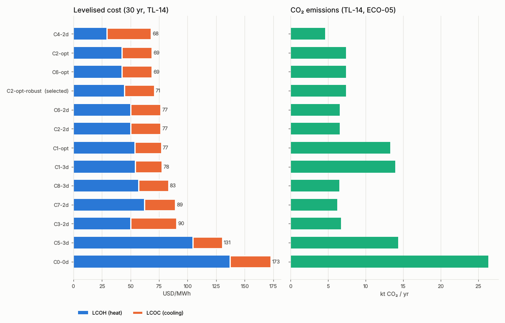
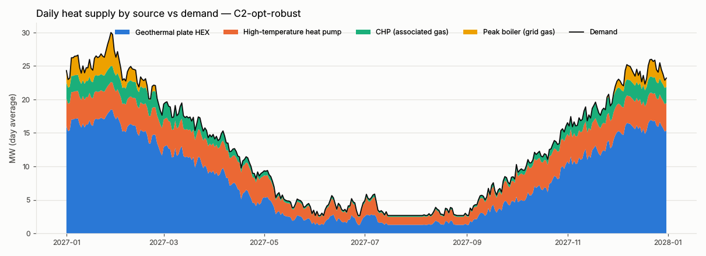
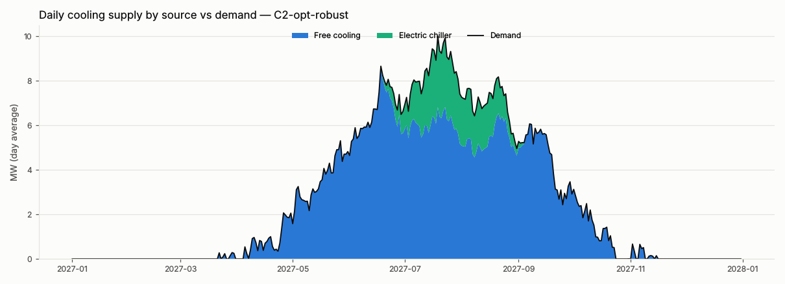
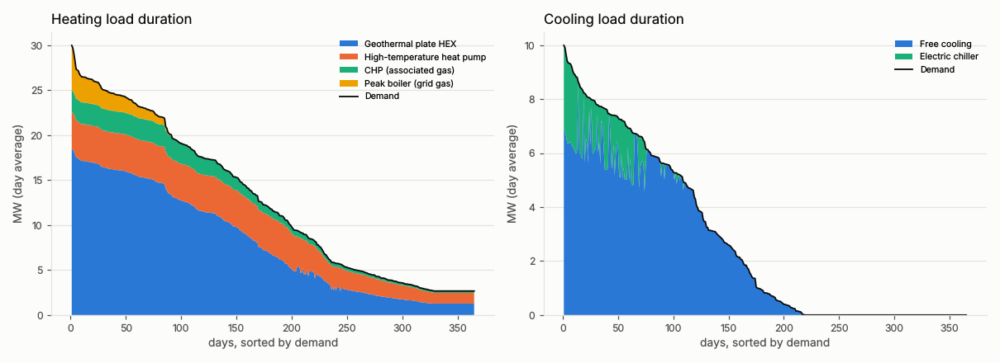
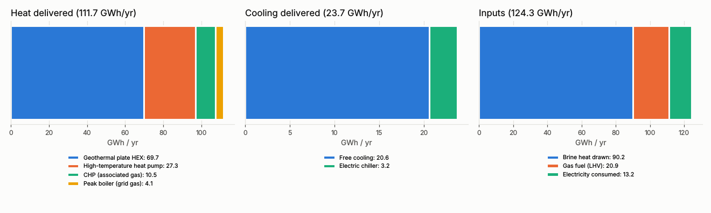
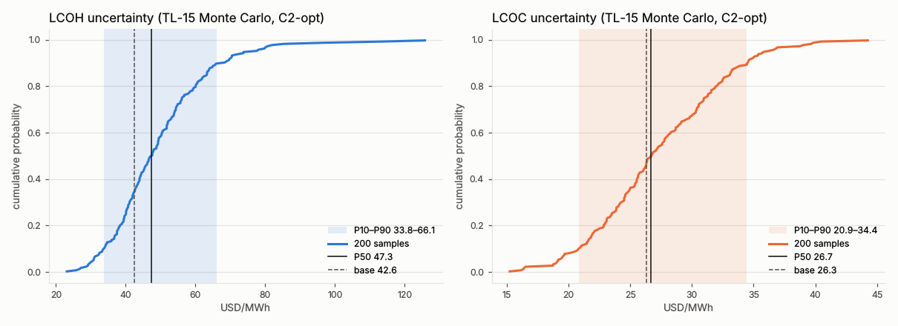
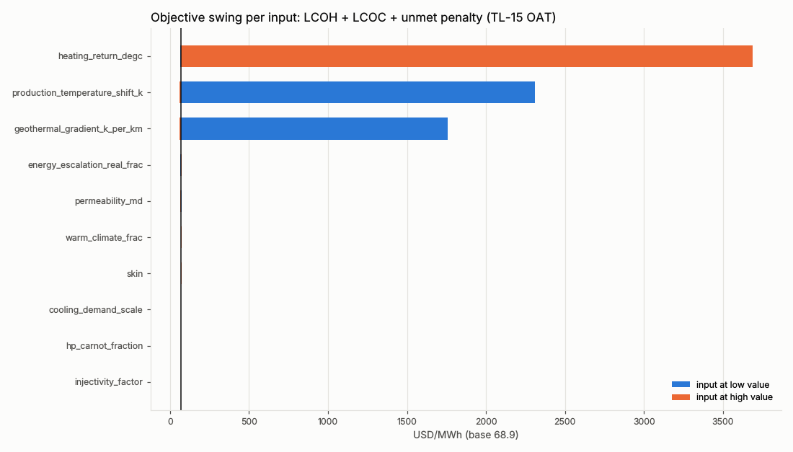
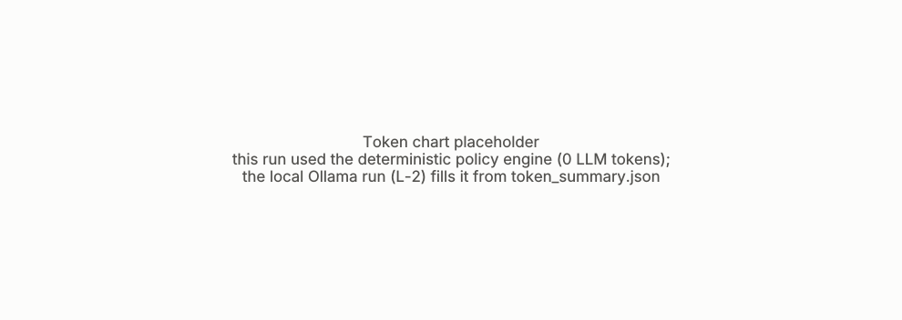

# GeoAgent design report — run final_policy

## Answer

- Recommended design: **C2-opt-robust** — C2-opt with the TL-15 P90 robust backups (OPT-ROBUST-BACKUP)
- Verifier verdict: **ACCEPTED**
- Unmet demand: heating 0 d / 0 MWh, cooling 0 d / 0 MWh
- LCOH 44.6 USD/MWh, LCOC 26.3 USD/MWh (30 yr, TL-14); CAPEX 30.1 MUSD
- CO₂ 7360 t/yr, 72% below the C0 counterfactual
- Exergy efficiency 0.44 (T0 = daily dry-bulb (DB-34d), De Bilt (KNMI) 2027: mean 10.5 °C, range 3.6–18.2 °C)
- Robustness (TL-15 on C2-opt, 200 samples): demand met in 46% of samples with the base-year backups {'peak_boiler_mw': 5.0, 'electric_chiller_mw': 8.2} MW; robust backups {'peak_boiler_mw': 10.9, 'electric_chiller_mw': 8.2} MW → 90% (installed by DR-11, policy)
- Backup capacity (DR-11): C2-opt-robust vs C2-opt: ΔLCOH +2.05, ΔLCOC +0.00 USD/MWh, ΔCAPEX +2.21 MUSD (full year, TL-12 + TL-14)

## Alternatives compared (C0–C8)

| candidate | concept | doublets | depth_m | flow_m3h | unmet_heat_d | unmet_cool_d | capex_musd | lcoh_usd_mwh | lcoc_usd_mwh | co2_t_yr | co2_cut_vs_c0 | exergy_eff | excluded |
|---|---|---|---|---|---|---|---|---|---|---|---|---|---|
| C0-0d | C0 | 0 | – | – | 0 | 0 | 13.7 | 137.0 | 36.0 | 26332 | – | 0.17 | – |
| C1-3d | C1 | 3 | 2500 | 300 | 0 | 0 | 28.3 | 54.2 | 23.6 | 13963 | 47% | 0.26 | – |
| C2-2d | C2 | 2 | 2500 | 300 | 0 | 0 | 34.3 | 50.3 | 26.3 | 6522 | 75% | 0.54 | – |
| C3-2d | C3 | 2 | 2500 | 300 | 0 | 0 | 37.0 | 50.0 | 40.4 | 6696 | 75% | 0.52 | – |
| C4-2d | C4 | 2 | 3200 | 300 | 0 | 0 | 34.7 | 29.4 | 38.7 | 4597 | 83% | 0.41 | excluded (PH-19) |
| C5-3d | C5 | 3 | 1500 | 300 | 0 | 0 | 56.4 | 104.5 | 26.1 | 14327 | 46% | 0.39 | – |
| C6-2d | C6 | 2 | 2500 | 300 | 0 | 0 | 34.3 | 50.3 | 26.3 | 6522 | 75% | 0.54 | – |
| C7-2d | C7 | 2 | 2500 | 300 | 0 | 0 | 34.8 | 62.1 | 27.3 | 6218 | 76% | 0.52 | – |
| C8-3d | C8 | 3 | 2500 | 300 | 0 | 0 | 41.4 | 57.0 | 26.3 | 6513 | 75% | 0.55 | – |
| C2-opt | C2 | 2 | 2500 | 296 | 0 | 0 | 27.9 | 42.5 | 26.3 | 7360 | 72% | 0.44 | – |
| C6-opt | C6 | 2 | 2500 | 296 | 0 | 0 | 27.9 | 42.6 | 26.3 | 7361 | 72% | 0.44 | – |
| C1-opt | C1 | 3 | 2500 | 265 | 0 | 0 | 28.2 | 53.8 | 23.5 | 13284 | 50% | 0.27 | – |
| C2-opt-robust * | C2 | 2 | 2500 | 296 | 0 | 0 | 30.1 | 44.6 | 26.3 | 7360 | 72% | 0.44 | – |

Rows `C*-Nd` are the spec §3.4 screening points (TL-12 fast year); `*-opt` rows are the TL-13 optima (P6); a `*-robust` row is an optimum with its TL-15 robust backups (P8, DR-11); `*` marks the selected design.
- TL-13 C2-opt (from C2-2d): depths excluded [3000.0, 3200.0, 3500.0] (verifier PH-19/PH-30, `depth_check`)
- TL-13 C6-opt (from C6-2d): depths excluded [3000.0, 3200.0, 3500.0] (verifier PH-19/PH-30, `depth_check`)
- TL-13 C1-opt (from C1-3d): depths excluded [3000.0, 3200.0, 3500.0] (verifier PH-19/PH-30, `depth_check`)

## Final design sizing

| Item | Value | Basis |
|---|---|---|
| Design | C2-opt-robust | C2-opt with the TL-15 P90 robust backups (OPT-ROBUST-BACKUP) |
| Doublets | 2 | DB-10: 1–3 |
| Reservoir depth | 2500 m | TL-13 (verifiable depth options) |
| Design flow per doublet | 296 m³/h | DB-11: 50–300 |
| Gas handling | degas_use | DR-07 |
| Heating return (DB-31) | 55 °C | supply 100 °C |
| Cooling return (DB-32) | 26 °C | supply 20 °C |
| electric_chiller_mw | 8.20 | TL-13 size / right-sized backup |
| hthp_heating_mw | 4.10 | TL-13 size / right-sized backup |
| peak_boiler_mw | 10.90 | TL-15 robust backup (DR-11, OPT-ROBUST-BACKUP); C2-opt: 5.00 |
| Outage start days (0-based) | [119, 238] | DR-06 |
| Depths excluded | [3000.0, 3200.0, 3500.0] | PH-19 NPSH / PH-30 letdown |
| Installed heating | 36.3 MW | TL-12 |
| Installed cooling | 16.8 MW | TL-12 |
| Doublet capacity factors (flow-based) | 0.52, 0.47 | TL-12 mean/design |
| Thermal breakthrough (annual-mean flow) | 66.1 yr | TL-12 end of life via TL-07 |
| Wellhead temperature (design flow) | 85.2 °C | TL-05 |
| ESP frequency | 58.1 Hz | TL-05 |
| ESP electric power per doublet | 0.446 MW | TL-05 QΔp/0.70/(0.93·0.97) |
| ESP intake margin over 1.2 · p_b | 0.86 bar | TL-05 (SUB-PBUB basis) |
| Injector wellhead pressure | 26.0 bar(g) | TL-05 |
| Injection pump electric power per doublet | 0.339 MW | TL-05 |
| Thermal breakthrough (design flow) | 34.4 yr | TL-07, ≥ 30 yr (ENG-06) |
| Doublet separation | 1131 m | TL-08 minimum for ≤ 1 bar |
| Well spacing | 1200 m | SUB-SPACING (≥ 1.2 km) |
| Scaling screen (TL-22) | insufficient data | calcite_inhibitor, no_copper, oxygen_exclusion, titanium_plates |
| PH-02 brine cooling 0–40 K | worst 40 K | margin 0 (verifier) |
| PH-18 ESP intake ≥ 1.2 · bubble point (RC-01 item 9 setpoint) | worst 55.1 bar | margin 0.864 (verifier) |
| PH-30 degassed brine below its boiling point at the letdown pressure | worst 85.2 degC | margin 14.8 (verifier) |
| PD-04 inter-doublet interference ≤ 1 bar | worst 1 bar | margin 0 (verifier) |
| PD-05 thermal breakthrough ≥ 30 yr | worst 34.4 yr | margin 4.4 (verifier) |

## Verification

**Verdict: ACCEPTED** (DesignVerifier) — DesignVerifier C2-opt-robust: ACCEPTED; all 46 checks pass; tightest PH-02 margin 0 K

Violations: none; not evaluated: none

| Check | Layer | Name | Status | Value | Limit | Margin | Unit |
|---|---|---|---|---|---|---|---|
| SY-01 | syntactic | GEMINI project JSON loads | pass | – | – | – |  |
| SY-02 | syntactic | schemas valid and consistent | pass | – | – | – |  |
| SY-03 | syntactic | unit suffixes present | pass | – | – | – |  |
| SE-01 | semantic | unique component names | pass | – | – | – |  |
| SE-02 | semantic | connections reference existing components and keys | pass | – | – | – |  |
| SE-03 | semantic | splitter fractions sum to 1 | pass | 1 | 1 | 0 | - |
| SE-04 | semantic | each producer paired with an injector | pass | 2 | 2 | – | count |
| PH-24 | physical | 1–3 doublets, matching the results | pass | 2 | 3 | 1 | count |
| PH-01 | physical | daily energy balance < 1 % (supplied + unmet = demand) | pass | 0 | 0.01 | 0.01 | frac |
| PH-02 | physical | brine cooling 0–40 K | pass | 40 | 40 | 0 | K |
| PH-03 | physical | 50–300 m3/h per active doublet, 0 on outage | pass | 50 | 300 | 0 | m3/h |
| PH-04 | physical | Q_inj = Q_prod | pass | 0 | 0 | 0 | m3/h |
| PH-05 | physical | heating supply 100 °C met | pass | 100 | 100 | 0 | degC |
| PH-06 | physical | cooling supply 20 °C met | pass | 20 | 20 | 0 | degC |
| PH-22 | physical | brine-side energy balance < 1 % (heat drawn = ρ·Q·c_p·ΔT; first law per user) | pass | 0 | 0.01 | 0.01 | frac |
| PH-07 | physical | plate-HEX approach ≥ 1.1 K | pass | 3 | 1.1 | 1.9 | K |
| PH-08 | physical | plate-HEX temperature within rating (gasketed 150 °C, welded 204 °C) | pass | 85.2 | – | 64.8 | degC |
| PH-09 | physical | plate-HEX pressure within rating (gasketed 20 bar, welded 20.7 bar(g)) | pass | 0 | – | 20 | bar |
| PH-10 | physical | plate-HEX Δp 1–6 psi per NTU (≈ 24 kPa/NTU) | pass | 24.13 | 41.37 | 17.24 | kPa |
| PH-11 | physical | plate-HEX NTU per pass 0.6–4.0 | pass | 3.022 | 4 | 0.9783 | - |
| PH-12 | physical | plate-HEX unit ≤ 1360 m3/h and ≤ 1208 m2 | pass | 0.6514 | 1 | 0.3486 | frac |
| PH-23 | physical | plate-HEX NTU consistent with its terminal temperatures (F_c 0.85–1) | pass | 9.065 | – | 0 | - |
| PH-13 | physical | heat-pump COP ≤ Carnot (condensing/evaporating temperatures) | pass | 3.328 | – | 2.219 | - |
| PH-14 | physical | heat-pump lift and COP within datasheet (or RC-04 defaults) | pass | 1 | 1 | 0 | frac |
| PH-15 | physical | absorption COP and capacity within GM-04 bounds | not_applicable | – | – | – |  |
| PH-16 | physical | absorption pumping ≤ 50 % of electric-chiller power | not_applicable | – | – | – |  |
| PH-17 | physical | pump shaft power = QΔp/0.7 | pass | 0 | 0.01 | 0.01 | frac |
| PH-18 | physical | ESP intake ≥ 1.2 · bubble point (RC-01 item 9 setpoint) | pass | 55.11 | – | 0.864 | bar |
| PH-19 | physical | NPSH_A ≥ NPSH_R + 15 m | pass | 545.4 | 15 | 530.4 | m |
| PH-20 | physical | no negative flows or powers | pass | 0 | 0 | 0 | MW |
| PH-21 | physical | simulation constraint margins ≥ 0 | pass | 0 | 0 | 0 | suffix |
| PH-25 | physical | TL-05 design point feasible | pass | 0 | 0 | 0 | infeasible points |
| PH-26 | physical | TL-05 ESP flow solve error ≤ 1 % | pass | 0 | 0.01 | 0.01 | frac |
| PH-27 | physical | ESP intake ≥ 1.2 · p_b at the design point (TL-05) | pass | 0.864 | 0 | 0.864 | bar |
| PH-28 | physical | cooling and heat-pump models within validity (RC-04…RC-07) | pass | 0 | 0 | 0 | invalid model points |
| PH-29 | physical | daily result flags (DayResult.flags) | pass | 0 | 0 | 0 | failing day flags |
| PH-30 | physical | degassed brine below its boiling point at the letdown pressure | pass | 85.2 | 100 | 14.8 | degC |
| PD-01 | performance_design | unmet demand = 0 | pass | 0 | 0 | 0 | MWh |
| PD-02 | performance_design | planned outages do not overlap | pass | 1 | 1 | 0 | doublets |
| PD-03 | performance_design | well spacing ≥ 1.2 km | pass | 1200 | 1200 | 0 | m |
| PD-04 | performance_design | inter-doublet interference ≤ 1 bar | pass | 1 | 1 | 0 | bar |
| PD-05 | performance_design | thermal breakthrough ≥ 30 yr | pass | 34.4 | 30 | 4.405 | yr |
| PD-11 | performance_design | TL-08 interference within limit at the design separation | pass | 1 | 1 | 0 | flag |
| PD-12 | performance_design | TL-07 thermal breakthrough after the analysis horizon | pass | 1 | 1 | 0 | flag |
| PD-06 | performance_design | fast vs full simulation agree (≤ 5 % daily, per source) | pass | 0.00298 | 0.05 | 0.04702 | frac |
| PD-07 | performance_design | scaling screen passed or mitigated | pass | 0 | 0 | 0 | count |
| PD-08 | performance_design | materials compatible (no Cu in brine; Ti plates for saline brine) | pass | 0 | 0 | 0 | count |
| PD-09 | performance_design | sanity envelope: production temperature ≤ reservoir temperature | pass | 85.2 | 87 | 1.804 | degC |
| PD-10 | performance_design | pressurised brine loop ≥ CO₂-release setpoint (RC-01 item 9) | not_applicable | – | – | – |  |
| EX-01 | exergy | exergy utilisation reported | info | – | – | – | frac |

## Uncertainty

TL-15 on C2-opt (base-year backups); the selected C2-opt-robust installs its robust backups (DR-11, OPT-ROBUST-BACKUP).

| KPI | P10 | P50 | P90 |
|---|---|---|---|
| capex_million | 23.58 | 27.03 | 30.52 |
| co2_t_per_yr | 5311.90 | 8329.11 | 11919.68 |
| lcoc_per_mwh | 20.86 | 26.70 | 34.45 |
| lcoh_per_mwh | 33.79 | 47.30 | 66.14 |
| lcoh_plus_lcoc_per_mwh | 59.35 | 73.86 | 96.52 |
| required_electric_chiller_mw | 8.20 | 8.20 | 8.20 |
| required_peak_boiler_mw | 5.00 | 5.38 | 10.85 |
| thermal_breakthrough_yr | 47.98 | 70.51 | 101.14 |
| unmet_cooling_days | 0.00 | 0.00 | 0.00 |
| unmet_cooling_mwh | 0.00 | 0.00 | 0.00 |
| unmet_heating_days | 0.00 | 2.00 | 71.00 |
| unmet_heating_mwh | 0.00 | 13.31 | 2772.52 |

Samples 200 (failed 0); P(demand met) at installed backups 0.46; robust backups {'peak_boiler_mw': 10.9, 'electric_chiller_mw': 8.2} → P 0.9

| Case | Register id | Value | LCOH | LCOC | Unmet MWh |
|---|---|---|---|---|---|
| ECO-CO2-GAS=51.53 | ECO-CO2-GAS | 51.53 | 42.5 | 26.3 | 0 |
| DB-31=45 | DB-31 | 45.0 | 36.5 | 26.1 | 0 |
| DB-31=65 | DB-31 | 65.0 | 54.7 | 26.5 | 2605 |
| DB-31=75 | DB-31 | 75.0 | 74.9 | 26.5 | 17727 |
| CHP-EL-FRAC=0.5 | CHP-EL-FRAC | 0.5 | 41.4 | 25.8 | 23 |
| SUB-PBUB.basis=pure_water | SUB-PBUB | pure_water | 42.6 | 26.3 | 0 |
| DB-34b=warm | DB-34b | True | 42.7 | 32.9 | 0 |
| DB-30=B | DB-30 | B | 43.4 | 30.4 | 0 |

## Figures

## Model gaps and limitations (TL-17)

- Missing component types: none
- LIM-SUB-01 ESP has no flow affinity: ESP curve power is approximate at part load.
- LIM-SUB-02 Constant brine PVT: Injection pressure and pump power underestimated at the injector.
- LIM-SUB-03 Steady wellbore heat loss: Low-flow wellhead temperature is conservative (heat underestimated).
- LIM-SUB-04 ESP motor heating not modelled: Wellhead temperature slightly underestimated.
- LIM-SUB-05 No fracture-pressure limit: A high-rate injection point could exceed a fracture limit unnoticed.
- LIM-SUB-06 No flashing check above 100 °C: Deep-concept surface pressures may be optimistic.
- LIM-SUB-07 ESP far from BEP at minimum flow: Minimum-flow efficiency and pump life uncertain.
- LIM-SUB-08 Standalone esp type is water-only: A project using 'esp' directly underestimates brine pump Δp and power.
- LIM-PLT-01 No storage component in the plant generator: C6 benefit rests on dispatch bookkeeping (STO-REC-HT), not a simulated storage loop.
- LIM-PLT-02 Heat-pump fouling not modelled: COP slightly optimistic over the plant life.
- LIM-PLT-03 HEX imprecise for balanced flows: Balanced-flow HEX duty has a small error.
- LIM-PLT-04 HEX temperature difference uses abs(): A mis-wired or off-design HEX can report positive duty.
- LIM-PLT-05 No absorption isolation loop: Drive temperature optimistic by one HEX approach.
- LIM-GEM-01 GEMINI Compressor omits k and drive losses: Unused by the plant; would underestimate power if used.
- LIM-TOOL-01 Private well_flow helpers used as API: Renaming them breaks TL-05/TL-06.

## Decision Records

- DR-09 Materials: Titanium HEX plates, no copper alloys in contact with brine (policy; criterion spec-materials-check)
- DR-01 Number of doublets: 2 doublet(s) (policy; criterion ranking-lowest-lcoh_per_mwh)
- DR-02 Well depth: Reservoir at 2500 m TVD (policy; criterion ranking-lowest-lcoh_per_mwh)
- DR-03 Heat top-up technology: Plate HEX + HTHP in series + CHP + peak boiler (C2/C3) (policy; criterion ranking-lowest-lcoh_per_mwh)
- DR-04 Cooling technology mix: Free cooling + electric chillers (C2, C5) (policy; criterion ranking-lowest-lcoh_per_mwh)
- DR-05 Storage yes/no: No seasonal storage (policy; criterion ranking-lowest-lcoh_per_mwh)
- DR-07 Gas handling (degas + CHP vs pressurised reinjection): Gas handling: degas_use (policy; criterion ranking-lowest-lcoh_per_mwh)
- DR-08 Return temperature: District-heating return 55 degC (policy; criterion db31-answer)
- DR-06 Maintenance windows: Outages placed by the optimiser in the lowest-load windows, never overlapping (DB-30) (policy; criterion db30-non-overlapping)
- DR-11 Backup capacity (robustness): Install the TL-15 P90 robust backups (electric_chiller_mw 8.20, peak_boiler_mw 10.90 MW) as C2-opt-robust (policy; criterion opt-robust-backup)
- DR-10 Final selection: C2-opt-robust (C2-opt with the TL-15 P90 robust backups (OPT-ROBUST-BACKUP)) (policy; criterion selected-not-rejected)

## Assumptions and answers

- DB-30 = {"interpretation":"A","doublet_available_days_per_yr":330,"planned_outage_days_per_doublet":35,"outages_may_overlap":false,"outage_schedule":"chosen by the optimiser","demand_met_days_per_yr":365} (assumed: register default)
- DB-31 = 55.0 degC (assumed: register default)
- DB-32 = 26.0 degC (assumed: register default)
- Human approval pending (non-interactive run)
