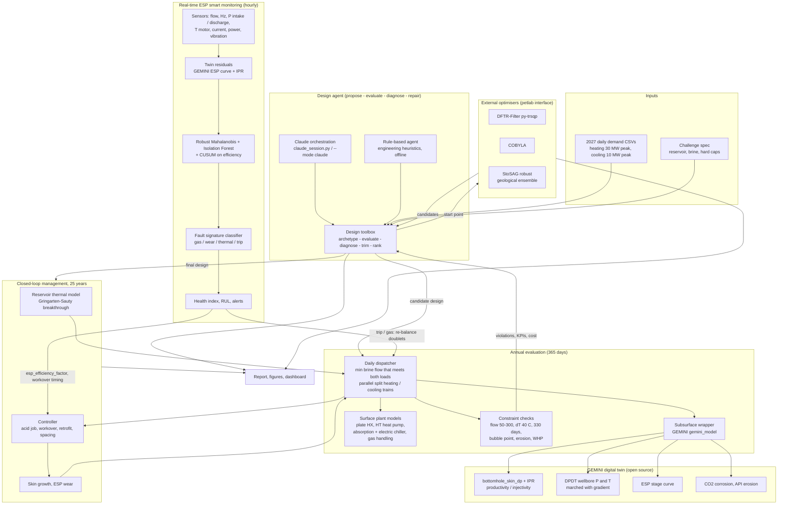

# Architecture

**Reading the loop.** The toolbox proposes a design; the dispatcher runs it through every day of
the year, calling the GEMINI well models at the flow each day needs; constraint checks return
violations, KPIs and cost; the diagnoser maps the worst violation to an engineering repair; the
loop repeats until the twin stops objecting. The same toolbox is then the objective function for
the external optimisers and the yearly evaluator inside the 25-year management loop.

**Reading the monitor.** Hourly sensor data is compared with the same twin; three detectors
flag deviations, a signature classifier names the fault, and the resulting health index and
remaining useful life replace the assumed ESP wear rate in the 25-year loop and bring the
workover forward when needed. A trip or gas slug is handed to the daily dispatcher, which
re-balances flow across the remaining doublets exactly as it does for maintenance windows.
