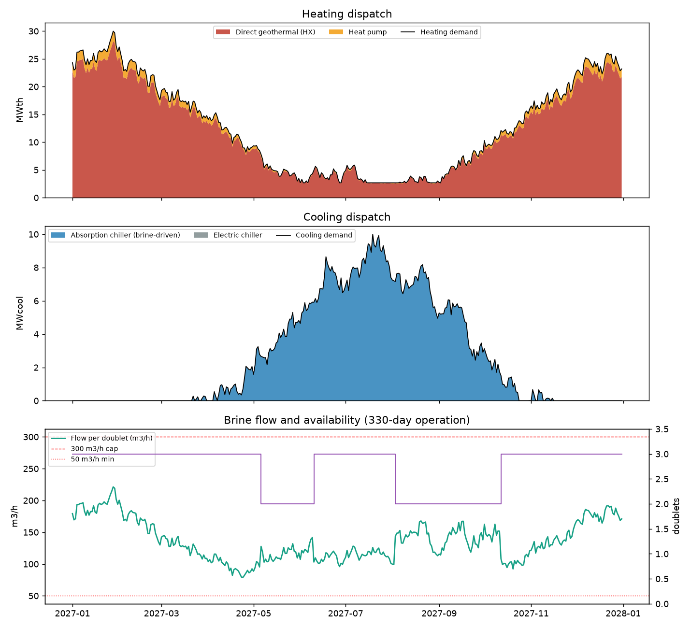
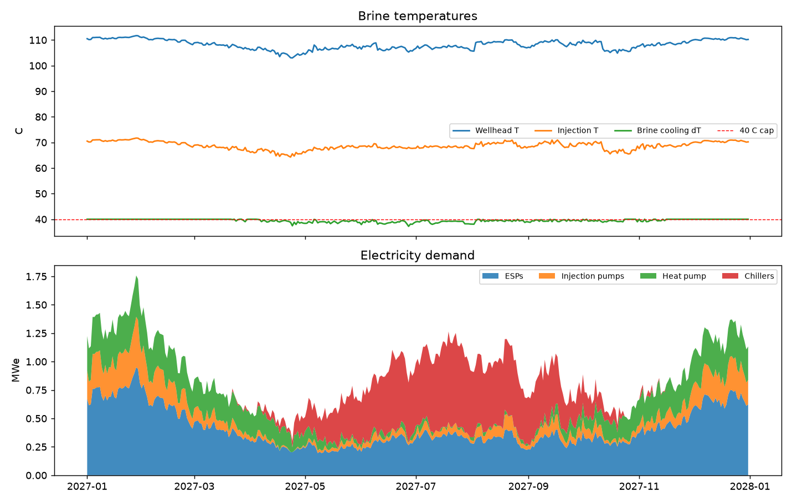
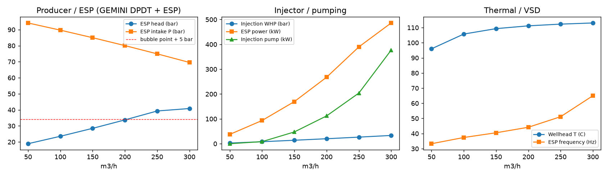
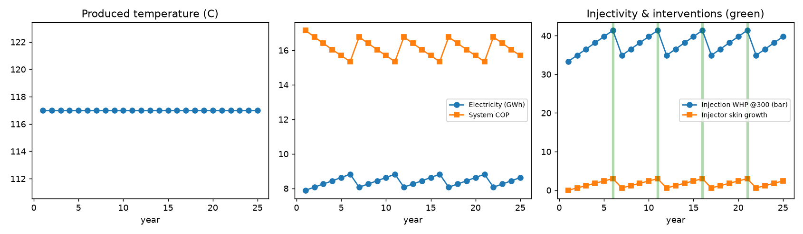

# GEMINI Agentic Geothermal Design - Final Design Report

Orchestration mode: **Claude (Claude Code session orchestrating the toolbox)**. Subsurface / well engineering evaluated with the GEMINI digital-twin models (`gemini_model`: radial Darcy inflow, IPR, DPDT wellbore pressure-temperature, ESP curve, CO2 corrosion, API erosional velocity). Heating and cooling plant evaluated with the complementary component models in `gemini_design_agent/components.py`.

## 1. Selected design

| Item | Value | Note |
|---|---|---|
| Number of doublets | 3 | challenge range 1-3 |
| Reservoir midpoint depth | 3500 m TVD | reservoir T 117.0 C, P 351 bar(g) |
| Well measured depth | 3780 m MD | deviated, MD = 1.08 x TVD |
| Production / injection casing ID | 217 / 217 mm |  |
| ESP setting depth | 1000 m | intake 70 bar at 300 m3/h vs bubble point 29 bar |
| ESP | 26 stages, BEP 170 m3/h, VSD 30-65 Hz | 486 kW at 300 m3/h |
| High-temperature heat pump | 2.5 MWth | brine-source, 100 C supply |
| Absorption chiller | 10.0 MWcool | single-effect LiBr, brine-driven |
| Electric chiller | 0.0 MWcool | backup / peak |
| District heating return | 60 C | assumption |
| Corrosion mitigation | inhibitor+GRE-lined tubing | un-mitigated rate 8.2 mm/yr (GEMINI DLM, 20 mol% CO2) |
| Maintenance windows (35 d per doublet) | 2027-05-06 to 2027-06-09; 2027-08-03 to 2027-09-06; 2027-09-07 to 2027-10-11 | staggered, lowest-load period |

### Why this design

- Deeper target: at 3,500 m the reservoir is 117 C and the wellhead ~114 C, which permits direct plate-HX supply at 100 C and gives the absorption chiller a full-COP driving temperature. Three doublets because the 40 C brine-cooling cap limits each doublet to ~13.4 MW and the peak is 30 MW.
- Brine ~114 C allows direct 100 C supply; heat pump kept small (7.5 MW) for top-up.
- Single-effect absorption chiller (10.0 MW) driven by 114 C brine covers the cooling peak.
- Right-sizing: the annual simulation used at most ~1.8 MW of heat-pump output (cold-spell top-up when direct HX is at the 40 C cap), so the heat pump is trimmed from 7.5 to 2.5 MW, saving ~3.8 MEUR capex. The ESP frame is re-selected with BEP 170 m3/h (= 221 m3/h peak / 1.3) so the peak sits inside the pump window; low-flow days are handled by VSD turndown and a recirculation line.

## 2. Demand interpretation

| Load | Peak | Annual energy | Note |
|---|---|---|---|
| Heating | 30.0 MW on 2027-01-28 | 111.7 GWh/yr | min 2.7 MW |
| Cooling | 10.0 MW on 2027-07-19 | 23.7 GWh/yr | 219 days with cooling |

Heating duration: 25.0 MW exceeded 30 days, 20.1 MW exceeded 90 days, 11.9 MW exceeded 180 days. Daily energy = power x 24 h.

## 3. Annual power and energy balance (330 operating days per doublet)

| Quantity | Value | Detail |
|---|---|---|
| Heat delivered | 111.67 GWh | direct 105.13 + heat pump 6.54 |
| Cooling delivered | 23.74 GWh | absorption 23.74 + electric 0.00 |
| Unmet demand | heat 0.000 / cool 0.000 GWh | must be 0 for feasibility |
| Geothermal heat extracted | 143.26 GWh | peak 29.6 MW |
| Electricity | 7.81 GWh | ESP 3.60, injection 0.94, heat pump 1.38, chillers 1.89 |
| System COP | 17.3 | (heat + cool) / electricity |
| Geothermal (non-electric) share | 94 % | (delivered - electricity) / delivered |
| Flow per doublet | peak 221, mean 136 m3/h | 0 d at cap, 0 d at 50 m3/h minimum |
| Produced = injected volume | 3.24 Mm3/yr | equal liquid volumes, same reservoir |
| Max brine cooling | 40.0 C | cap 40 C; min injection T 64.3 C |
| Associated gas | 2.59 MNm3/yr | GLR 0.8; CO2 1026 t/yr to treatment, CH4 to flare/engine |

## 4. Constraint check (final design)

| Constraint | Value | Status |
|---|---|---|
| Doublets 1-3 | 3 | PASS |
| Max 300 m3/h per doublet | 221.3 | PASS |
| Min 50 m3/h while active | enforced by dispatcher (bypass at minimum) | PASS |
| Max 40 C brine cooling | 40.0 | PASS |
| Pump efficiency 70 % | applied to ESP and injection pump | PASS |
| Production / injection balance | equal volumes | PASS |
| 330 operating days per doublet | 35-day staggered outages | PASS |
| 100 C heating supply | direct HX (if brine >= 103 C) / heat pump | PASS |
| 20 C cooling supply | absorption / electric chillers | PASS |
| ESP intake above bubble point | 70 bar vs 29 bar | PASS |
| Tubing velocity < API erosional | 2.26 < 4.75 m/s | PASS |
| Injection WHP limit | 33.3 bar < 60 | PASS |

## 5. Subsurface / well engineering (GEMINI models)

| Flow m3/h | Prod BHP bar | ESP intake bar | ESP head bar | Hz | ESP kW | WH T C | Inj WHP bar | Inj pump kW | v m/s |
|---|---|---|---|---|---|---|---|---|---|
| 50.00 | 346.92 | 94.16 | 18.90 | 33.29 | 37.51 | 95.99 | 2.55 | 0.00 | 0.38 |
| 100.00 | 342.83 | 89.69 | 23.54 | 37.40 | 93.40 | 105.73 | 8.08 | 8.39 | 0.75 |
| 150.00 | 338.73 | 84.98 | 28.48 | 40.51 | 169.55 | 109.31 | 13.92 | 47.36 | 1.13 |
| 200.00 | 334.64 | 80.06 | 33.74 | 44.16 | 267.77 | 111.16 | 20.07 | 111.97 | 1.50 |
| 250.00 | 330.55 | 74.92 | 39.30 | 51.13 | 389.90 | 112.29 | 26.53 | 204.03 | 1.88 |
| 300.00 | 326.46 | 69.56 | 40.84 | 65.00 | 486.17 | 113.06 | 33.29 | 376.91 | 2.26 |

Productivity index 12.2 m3/h/bar, injectivity index 10.0 m3/h/bar (radial Darcy, k = 200 mD, h = 100 m, re = 1000 m, injector skin 2.0).

## 6. Agent trajectory - how the design was reached

| # | Phase | Design | Action | Feasible | Hard violations | COP | Annual MEUR | EUR/MWh |
|---|---|---|---|---|---|---|---|---|
| 1 | claude | base-2dbl-2500m-abs | build candidate | yes | - | 3.8 | 11.64 | 86.0 |
| 2 | claude | deep-3dbl-3500m-abs | build candidate | yes | - | 17.3 | 9.02 | 66.6 |
| 3 | claude | mid-3dbl-3000m-abs | build candidate | yes | - | 5.1 | 12.47 | 92.1 |
| 4 | claude | deeper-3dbl-4000m-abs | build candidate | yes | - | 18.4 | 9.57 | 70.7 |
| 5 | claude | two-2dbl-3500m-abs-hp15 | modify ['n_doublets', 'heat_pump_mw'] | no | unmet_heating (12 d, worst 2.91); unmet_cooling (8 d, worst 1.10) | 13.7 | 7.73 | 57.2 |
| 6 | claude | deep-3dbl-3500m-electric | modify ['absorption_chiller_mw', 'electric_chiller_mw'] | yes | - | 11.2 | 9.28 | 68.5 |
| 7 | claude | final-3dbl-3500m-abs-trim | modify ['heat_pump_mw', 'well.esp_bep_m3_h'] | yes | - | 17.3 | 8.63 | 63.8 |
| 8 | claude | final-3dbl-3500m-abs-trim | finalize | yes | - | 0.0 | 0.00 | 0.0 |

Decision log:

1. **build candidate** (base-2dbl-2500m-abs): Start at the specified 2,500 m reservoir with two doublets (one doublet cannot cover 365 days under the 330-day rule). Brine ~85 C at the wellhead is below the 100 C supply, so I expect the heat pump to carry all heating; I size absorption cooling to see whether 85 C can drive it.
2. **build candidate** (deep-3dbl-3500m-abs): Deeper target: at 3,500 m the reservoir is 117 C and the wellhead ~114 C, which permits direct plate-HX supply at 100 C and gives the absorption chiller a full-COP driving temperature. Three doublets because the 40 C brine-cooling cap limits each doublet to ~13.4 MW and the peak is 30 MW.
3. **build candidate** (mid-3dbl-3000m-abs): Intermediate depth: at 3,000 m the wellhead is ~99-100 C, right at the edge of direct 100 C supply. This tests whether a shallower, cheaper well can avoid the large heat pump.
4. **build candidate** (deeper-3dbl-4000m-abs): Check whether going beyond 3,500 m still pays: hotter brine (~128 C wellhead) does not raise the 40 C cap on extracted heat, so I expect higher well capex with little operating gain.
5. **modify ['n_doublets', 'heat_pump_mw']** (two-2dbl-3500m-abs-hp15): Test whether two doublets at 3,500 m can cover the 30 MW peak if the heat pump is enlarged to 15 MW: the two doublets give ~26.8 MW of direct heat at the 40 C cap, and the heat pump could add compressor work on top.
6. **modify ['absorption_chiller_mw', 'electric_chiller_mw']** (deep-3dbl-3500m-electric): Comparison: replace the absorption chiller with a 10 MW electric chiller to quantify what brine-driven cooling is worth in electricity and cost.
7. **modify ['heat_pump_mw', 'well.esp_bep_m3_h']** (final-3dbl-3500m-abs-trim): Right-sizing: the annual simulation used at most ~1.8 MW of heat-pump output (cold-spell top-up when direct HX is at the 40 C cap), so the heat pump is trimmed from 7.5 to 2.5 MW, saving ~3.8 MEUR capex. The ESP frame is re-selected with BEP 170 m3/h (= 221 m3/h peak / 1.3) so the peak sits inside the pump window; low-flow days are handled by VSD turndown and a recirculation line.
8. **finalize** (final-3dbl-3500m-abs-trim): Selected: three doublets at 3,500 m (117 C reservoir, ~114 C wellhead) with direct plate-HX heating at 100 C, a 10 MW single-effect absorption chiller driven by the brine, and a 2.5 MW high-temperature heat pump for cold-spell top-up. Reasoning: (1) the 330-day rule makes one doublet infeasible and the 40 C brine-cooling cap limits each doublet to ~13.4 MW, so the 30 MW peak needs three doublets regardless of depth; (2) at the specified 2,500 m the brine is 85 C, below the 100 C supply, forcing a 31 MW heat pump and 36 GWh/yr of electricity (COP 3.8, 86 EUR/MWh); (3) 3,000 m is still just below the 103 C needed for direct supply and is the worst of both worlds (92 EUR/MWh); (4) 3,500 m enables direct supply and full-COP absorption cooling, cutting electricity to 7.8 GWh/yr (COP 17.3) at 63.8 EUR/MWh; (5) 4,000 m adds well cost without raising the cap-limited heat per doublet (70.7 EUR/MWh); (6) two doublets at 3,500 m fail on 16 peak days and during maintenance; (7) absorption cooling saves 4.3 GWh/yr and 0.65 MEUR/yr versus electric chillers. ESP set at 1,000 m keeps the intake 40 bar above the CH4 bubble point; tubing velocity 2.3 m/s is below the API erosional limit; CO2 corrosion (8 mm/yr un-mitigated) is handled with inhibitor and GRE-lined tubing. Trade-off: higher well capex (3 x 3,780 m MD) against the lowest electricity use and highest geothermal share of all feasible options.

## 7. Feasible alternatives compared

| Design | Dbl | Depth m | HP MW | Abs MW | El.ch MW | El GWh | COP | Geo % | Capex MEUR | Annual MEUR | EUR/MWh |
|---|---|---|---|---|---|---|---|---|---|---|---|
| final-3dbl-3500m-abs-trim | 3 | 3500 | 2.5 | 10.0 | 0.0 | 7.8 | 17.3 | 94 | 67.3 | 8.63 | 63.8 |
| deep-3dbl-3500m-abs | 3 | 3500 | 7.5 | 10.0 | 0.0 | 7.8 | 17.3 | 94 | 71.0 | 9.02 | 66.6 |
| deep-3dbl-3500m-electric | 3 | 3500 | 7.5 | 0.0 | 10.0 | 12.1 | 11.2 | 91 | 68.6 | 9.28 | 68.5 |
| deeper-3dbl-4000m-abs | 3 | 4000 | 7.5 | 10.0 | 0.0 | 7.4 | 18.4 | 95 | 76.9 | 9.57 | 70.7 |
| base-2dbl-2500m-abs | 2 | 2500 | 31.5 | 10.0 | 10.0 | 36.0 | 3.8 | 73 | 66.1 | 11.64 | 86.0 |
| mid-3dbl-3000m-abs | 3 | 3000 | 31.5 | 10.0 | 0.0 | 26.6 | 5.1 | 80 | 82.6 | 12.47 | 92.1 |

Cost assumptions: well_fixed_eur = 1.5e+06, well_per_m_md_eur = 1800, esp_eur_per_doublet = 900000, injection_pump_eur_per_doublet = 300000, surface_base_eur = 2.5e+06, surface_eur_per_mw_th = 120000, heat_pump_eur_per_mw = 750000, absorption_eur_per_mw = 400000, electric_chiller_eur_per_mw = 250000, cooling_tower_eur_per_mw_rejected = 80000, electricity_eur_per_mwh = 120, om_fraction_of_capex = 0.025, discount_rate = 0.06, lifetime_years = 25, esp_workover_eur_per_year_per_doublet = 250000.

## 8. Closed-loop geothermal management (25-year twin feedback)

Thermal breakthrough (Gringarten-Sauty) at the assumed well spacing: **125.8 years**; recommended producer-injector spacing at reservoir level: **732 m**.

- Breakthrough sensitivity to spacing: 600 m -> 20 yr, 800 m -> 36 yr, 1000 m -> 56 yr, 1200 m -> 81 yr, 1500 m -> 126 yr, 2000 m -> 224 yr.
- Lifetime electricity: 210 GWh (25.2 MEUR); interventions 19.2 MEUR.
- Years with hard violations before intervention: none.

| Year | Tprod C | Skin+ | ESP eff | Inj WHP | El GWh | COP | HP MW | Controller actions |
|---|---|---|---|---|---|---|---|---|
| 1 | 117.0 | 0.0 | 1.00 | 33 | 7.9 | 17.2 | 2.5 | - |
| 2 | 117.0 | 0.6 | 0.98 | 35 | 8.1 | 16.8 | 2.5 | - |
| 3 | 117.0 | 1.2 | 0.96 | 37 | 8.3 | 16.4 | 2.5 | - |
| 4 | 117.0 | 1.8 | 0.94 | 38 | 8.4 | 16.0 | 2.5 | - |
| 5 | 117.0 | 2.4 | 0.92 | 40 | 8.6 | 15.7 | 2.5 | - |
| 6 | 117.0 | 3.0 | 0.90 | 41 | 8.8 | 15.3 | 2.5 | acid stimulation of injectors (skin +3.0 -> 0; WHP 41 bar); ESP workover / replacement (efficiency factor 0.90 -> 1.00) |
| 7 | 117.0 | 0.6 | 0.98 | 35 | 8.1 | 16.8 | 2.5 | - |
| 8 | 117.0 | 1.2 | 0.96 | 37 | 8.3 | 16.4 | 2.5 | - |
| 9 | 117.0 | 1.8 | 0.94 | 38 | 8.4 | 16.0 | 2.5 | - |
| 10 | 117.0 | 2.4 | 0.92 | 40 | 8.6 | 15.7 | 2.5 | - |
| 11 | 117.0 | 3.0 | 0.90 | 41 | 8.8 | 15.3 | 2.5 | acid stimulation of injectors (skin +3.0 -> 0; WHP 41 bar); ESP workover / replacement (efficiency factor 0.90 -> 1.00) |
| 12 | 117.0 | 0.6 | 0.98 | 35 | 8.1 | 16.8 | 2.5 | - |
| 13 | 117.0 | 1.2 | 0.96 | 37 | 8.3 | 16.4 | 2.5 | - |
| 14 | 117.0 | 1.8 | 0.94 | 38 | 8.4 | 16.0 | 2.5 | - |
| 15 | 117.0 | 2.4 | 0.92 | 40 | 8.6 | 15.7 | 2.5 | - |
| 16 | 117.0 | 3.0 | 0.90 | 41 | 8.8 | 15.3 | 2.5 | acid stimulation of injectors (skin +3.0 -> 0; WHP 41 bar); ESP workover / replacement (efficiency factor 0.90 -> 1.00) |
| 17 | 117.0 | 0.6 | 0.98 | 35 | 8.1 | 16.8 | 2.5 | - |
| 18 | 117.0 | 1.2 | 0.96 | 37 | 8.3 | 16.4 | 2.5 | - |
| 19 | 117.0 | 1.8 | 0.94 | 38 | 8.4 | 16.0 | 2.5 | - |
| 20 | 117.0 | 2.4 | 0.92 | 40 | 8.6 | 15.7 | 2.5 | - |
| 21 | 117.0 | 3.0 | 0.90 | 41 | 8.8 | 15.3 | 2.5 | acid stimulation of injectors (skin +3.0 -> 0; WHP 41 bar); ESP workover / replacement (efficiency factor 0.90 -> 1.00) |
| 22 | 117.0 | 0.6 | 0.98 | 35 | 8.1 | 16.8 | 2.5 | - |
| 23 | 117.0 | 1.2 | 0.96 | 37 | 8.3 | 16.4 | 2.5 | - |
| 24 | 117.0 | 1.8 | 0.94 | 38 | 8.4 | 16.0 | 2.5 | - |
| 25 | 117.0 | 2.4 | 0.92 | 40 | 8.6 | 15.7 | 2.5 | - |

## 9. Figures

## 10. Modelling assumptions and limitations

- Reservoir temperature from the 30 C/km gradient and 12 C surface; pressure hydrostatic anchored on 250 bar(g) at 2,500 m; permeability assumed depth-independent (200 mD).
- Wellbore heat loss from the GEMINI DPDT model marched in 100 m segments with the geothermal gradient as ambient (U = 10 W/m2K in the model).
- ESP curve is the HC27000 stage curve in the GEMINI unit tests, affinity-scaled to the selected pump frame; power from hydraulic head at the specified 70 % efficiency.
- Heat pump COP = 0.5 x Carnot between evaporator (mean brine T - 5 C) and condenser (105 C); absorption chiller COP 0.72 at >= 95 C driving temperature, derated below, off below 72 C.
- Bubble point from a Henry-law estimate for the 0.8 Nm3/m3 CH4/CO2 GLR; ESP intake kept >= 5 bar above it.
- Costs are indicative planning figures (see section 7) for ranking alternatives, not a budget.
- The closed-loop module uses a lumped Gringarten-Sauty breakthrough model; a full reservoir simulation would refine the breakthrough timing.