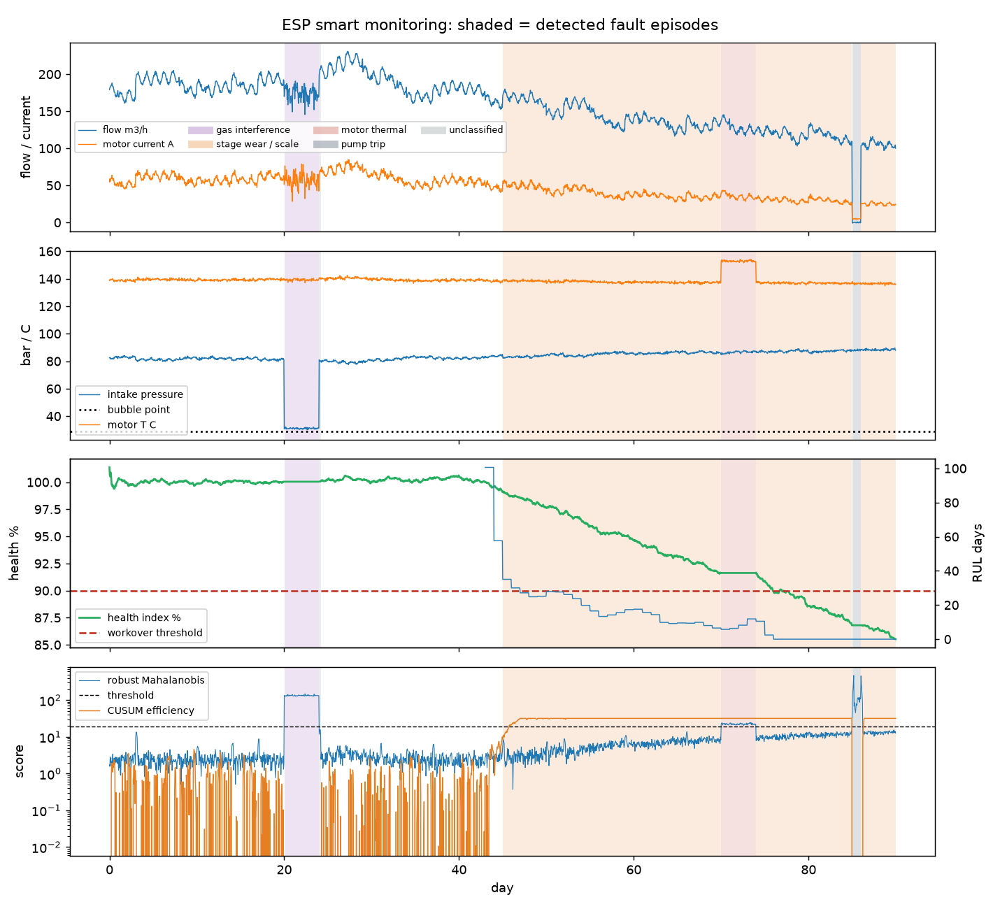

# Real-time ESP smart monitoring

Hourly telemetry of one producer ESP (flow, VSD frequency, intake and discharge pressure, intake and motor temperature, motor current, power, vibration) is compared with the GEMINI-based digital twin at every sample. The twin gives the expected head (affinity-scaled ESP stage curve at the measured frequency and flow), intake pressure (inflow performance) and power; the monitor works on the residuals.

**Detectors** (trained on the first 14 days, assumed healthy, no labels used):

1. Robust Mahalanobis distance (minimum-covariance-determinant) over seven standardised features: head, intake-pressure and power residuals, current and flow variability, motor temperature, vibration.
2. Isolation Forest on the same features (second opinion for non-elliptical deviations).
3. CUSUM on the hydraulic-efficiency estimate, integrating quiet hours only, for slow drift the first two miss.
4. Run/stop logic from motor current.

A sample is anomalous when any detector fires on 3 of the last 4 hours; a fault signature classifier then labels it (gas interference: intake within 8 bar of the bubble point with unstable current/flow; stage wear: head below the twin with rising vibration or CUSUM drift; motor thermal: motor temperature and power above the twin; trip: no-load current). A health index (EWMA of hydraulic efficiency relative to a new pump, quiet hours only) and a remaining-useful-life estimate (linear trend of the last 7 days to the 90 % workover threshold) are updated hourly; the index is the `esp_efficiency_factor` the 25-year closed loop uses, so field data replaces the assumed wear rate.

## Demo on the selected design (3 doublets, 3,500 m), January to March

Synthetic telemetry from the twin at the dispatcher's set-points, with four injected faults the detector was not told about: gas interference days 21-24, gradual stage wear from day 41, motor overheating days 71-74, pump trip day 86.

| Metric | Value |
|---|---|
| Hours monitored | 2160 |
| Recall on fault hours | 90.6 % |
| False-alarm rate on healthy hours | 0.69 % |
| Fault label accuracy on detected hours | 100 % |
| Health index at day 90 | 85.8 % (true hydraulic efficiency 85 %) |
| RUL at day 90 | workover due |
| Closed-loop override | esp_efficiency_factor = 0.86 |

## Alerts raised

| Day | Fault | Max distance | Recommended action |
|---|---|---|---|
| 21 | gas interference | 149 | Intake within 8 bar of the bubble point with unstable current: reduce VSD frequency 2-3 Hz to raise intake pressure, re-balance flow to the other doublets; if recurring, set the ESP deeper at the next workover. |
| 46 | stage wear / scale | 14 | Hydraulic efficiency drifting down with rising vibration (scale or stage wear): book an ESP workover when RUL falls under 90 days; meanwhile hold frequency and let the dispatcher share load across doublets. |
| 71 | motor thermal | 24 | Motor temperature and power above the twin with normal flow: check motor cooling flow past the housing and the VSD harmonics; derate to 45 Hz until cleared. |
| 75 | stage wear / scale | 14 | Hydraulic efficiency drifting down with rising vibration (scale or stage wear): book an ESP workover when RUL falls under 90 days; meanwhile hold frequency and let the dispatcher share load across doublets. |
| 86 | pump trip | 471 | Pump stopped (no-load current, zero flow): dispatcher moves the load to the remaining doublets within the 300 m3/h cap; investigate shaft or electrical fault before restart. |
| 87 | stage wear / scale | 456 | Hydraulic efficiency drifting down with rising vibration (scale or stage wear): book an ESP workover when RUL falls under 90 days; meanwhile hold frequency and let the dispatcher share load across doublets. |

## Wiring into the agentic loop

- Trip or gas interference: the daily dispatcher re-balances flow to the other doublets inside the 50-300 m3/h band (the same code path as the maintenance windows).
- Wear: the RUL feeds the closed-loop controller, which books the ESP workover at the next low-load window instead of on a fixed 5-year cycle.
- The health index replaces the assumed 2 %/yr efficiency loss in the 25-year twin (`esp_efficiency_factor` override).
- Limitations: telemetry is synthetic (no field data in the challenge); thresholds are set on a 14-day healthy window and would be re-tuned per well; the classifier is signature-based, a learned classifier needs labelled field events.

