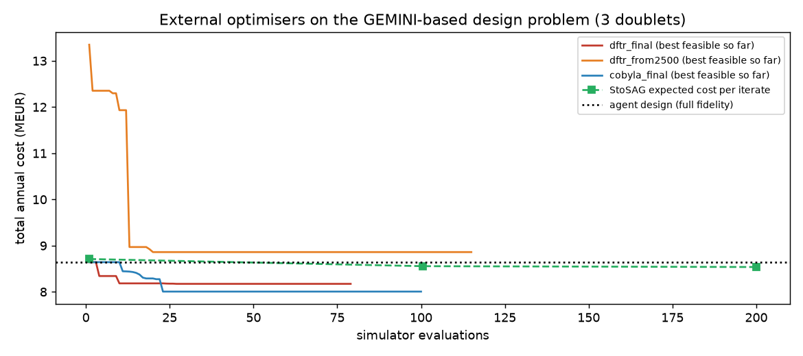

# External optimiser study (petlab / py-trsqp DFTR-Filter / StoSAG)

Continuous design variables for the 3-doublet system were handed to black-box optimisers through petlab's backend interface (`petlab.optimization.optimize`): **DFTR-Filter** (`py_trsqp`, derivative-free trust region with output constraints), **COBYLA** (scipy baseline) and **StoSAG** (ensemble-gradient robust optimisation over permeability 140-220 mD, gradient 29-32 C/km and injector skin). Objective: total annual cost (MEUR); constraints: zero unmet demand, ESP intake >= bubble point + 5 bar, injection WHP limit, API erosional velocity. Screening used the fast evaluator (every 2nd/3rd day, filled forward); every candidate was then re-run at full daily fidelity and, if marginally infeasible, repaired by the rule-based diagnoser.

## Candidates after full-fidelity polish

| Candidate | depth m | HP MW | abs MW | el.ch MW | ESP m | BEP | feasible | WH T C | el GWh | COP | capex MEUR | annual MEUR | EUR/MWh | E[cost] ens | worst ens | feas % ens |
|---|---|---|---|---|---|---|---|---|---|---|---|---|---|---|---|---|
| agent (Claude / rule-based) | 3500 | 2.5 | 10.0 | 0.0 | 1000 | 170 | yes | 113 | 7.8 | 17.3 | 67.3 | 8.63 | 63.8 | 8.70 | 8.86 | 100 |
| dftr_final | 3344 | 0.0 | 10.0 | 0.0 | 984 | 231 | yes | 109 | 7.1 | 19.1 | 63.6 | 8.17 | 60.3 | 8.31 | 8.65 | 100 |
| dftr_from2500 | 3938 | 0.0 | 0.0 | 10.2 | 1500 | 300 | yes | 125 | 9.0 | 15.1 | 68.2 | 8.86 | 65.4 | 8.91 | 9.02 | 100 |
| cobyla_final | 3246 | 0.0 | 11.5 | 0.0 | 1000 | 170 | yes | 106 | 8.3 | 16.4 | 63.4 | 8.28 | 61.2 | 8.80 | 10.63 | 83 |
| stosag_robust | 3335 | 1.9 | 10.0 | 0.3 | 991 | 172 | yes | 108 | 8.0 | 16.8 | 65.0 | 8.42 | 62.2 | 8.54 | 8.88 | 100 |

## Optimiser runs

- `dftr_final` (DFTR): 101 evaluations in 3 min, termination 'Approximate KKT point'; best feasible screened point 8.173 MEUR at x = [3343.7, 0.0, 9.7, 0.0, 984.4, 164.6].
- `dftr_from2500` (DFTR): 115 evaluations in 5 min, termination 'Maximum iterations'; best feasible screened point 8.861 MEUR at x = [3937.5, -1.7, -0.7, 10.2, 1720.5, 300.0].
- `cobyla_final` (COBYLA): 112 evaluations in 3 min, termination ''; best feasible screened point 8.006 MEUR at x = [3245.8, 0.0, 11.5, -8.0, 1000.0, 170.0].
- `stosag_robust` (StoSAG, 6 realisations): 306 evaluations in 10 min; iterate expected cost 8.71, 8.56, 8.54 MEUR; final expected 8.54, worst 8.88, feasible in 100 % of realisations; x = [3334.7, 1.9, 10.0, 0.3, 991.1, 171.5].
- `robust_nominal` (agent design across the ensemble): expected 8.70, worst 8.86 MEUR, feasible in 100 %.

## Interpretation

- Lowest nominal annual cost: **dftr_final** at 8.17 MEUR (60.3 EUR/MWh) versus 8.63 MEUR for the agent design (5.4 % lower).
- Most robust (lowest worst-case cost over the geological ensemble): **dftr_final** (worst 8.65 MEUR, expected 8.31).
- The design space has a cliff: the shallowest depth whose wellhead temperature still clears the 103 C needed for direct 100 C supply (about 3,250 m at 30 C/km). COBYLA sat right on it (3,250 m, no heat pump) and a 1 C/km lower gradient pushes its wellhead below the threshold, so its worst-case cost jumps to 10.6 MEUR. DFTR-Filter stopped about 100 m deeper (3,344 m) and the rule-based polish re-selected its ESP frame; that margin is enough for it to stay the cheapest design in every realisation. StoSAG, optimising the ensemble mean, lands at 3,335 m but keeps a 1.9 MW heat pump as a hedge.
- Fast-mode screening (every 2nd day) can miss one or two peak days; full-fidelity re-evaluation and the rule-based repair step are therefore part of the loop, not an afterthought.
- Recommendation: adopt the robust-optimised depth/capacities if the gradient uncertainty is real for the site; adopt the deterministic optimum only once a temperature log confirms the gradient.

